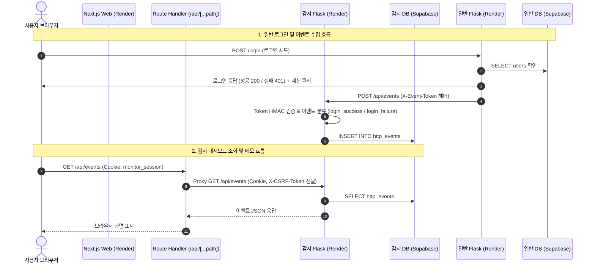

# 클라우드 배포 계획서 및 아키텍처 명세서 (Deployment Plan)

본 문서는 일반 서비스(`general`), 감시 API(`monitor/backend`), 감시 웹 화면(`monitor/next-frontend`)의 Render 클라우드 배포, Supabase 외부 데이터베이스 연동, Sentry 오류 추적 파이프라인 구성 및 실습 오류 패치 내역을 기술합니다.

---

## 1. 배포 개요 및 브랜치 전략

- **배포 대상 브랜치**: `day2-deploy`
- **배포 플랫폼**: Render (Docker Web Service, Hobby/Free 무료 플랜)
- **배포 트리거 (Auto-Deploy)**: `On Commit` (선택된 배포 브랜치에 커밋 푸시 시 자동 빌드 및 롤링 배포)
- **로컬 실행(Docker Compose)과 Render 배포의 차이점**:
  - **로컬 환경 (`compose-*.yaml`, `gateways/`)**: 호스트 게이트웨이(Nginx)가 단일 진입점(포트 8081, 8082) 역할을 하며, 내부 브리지 네트워크(`front-net`, `data-net`, `events-net`)를 통해 로컬 PostgreSQL 컨테이너와 통신합니다.
  - **Render 클라우드 배포**: Nginx 게이트웨이와 로컬 DB 컨테이너를 사용하지 않습니다. 각 서비스는 독립된 Docker Web Service로 격리 실행되며, 런타임 환경변수(`PORT`)를 통해 동적 포트에 바인딩됩니다. 데이터 저장은 완전 관리형 Supabase PostgreSQL Session pooler를 통해 외부 통신(SSL require)으로 처리됩니다.

---

## 2. 앱별 Render 배포 구성 명세

| 구분 | 일반 앱 (`general`) | 감시 API (`monitor/backend`) | 감시 화면 (`monitor/next-frontend`) |
| :--- | :--- | :--- | :--- |
| **서비스 유형** | Web Service (Docker) | Web Service (Docker) | Web Service (Docker) |
| **Root Directory** | `general` | `monitor/backend` | `monitor/next-frontend` |
| **Dockerfile Path** | `./Dockerfile` | `./Dockerfile` | `./Dockerfile` |
| **Build Context** | `.` | `.` | `.` |
| **Docker Command** | *(빈칸 - Dockerfile CMD 사용)* | *(빈칸 - Dockerfile CMD 사용)* | *(빈칸 - Dockerfile CMD 사용)* |
| **Health Check Path**| `/health` | `/health` | `/` |
| **컨테이너 런타임** | Python 3.13-slim + Waitress WSGI | Python 3.13-slim + Waitress WSGI | Node.js 24-bookworm-slim |
| **실행 명령어** | `waitress-serve --host=0.0.0.0 --port=$PORT app:app` | `waitress-serve --host=0.0.0.0 --port=$PORT app:app` | `npm run start -- --hostname 0.0.0.0` |
| **배포 상태** | 배포 준비 완료 (미배포 / 로컬 검증 완료) | 배포 준비 완료 (미배포 / 로컬 검증 완료) | 배포 준비 완료 (미배포 / 로컬 검증 완료) |

### 2.1 Flask 애플리케이션 실행 환경 및 Waitress 구성
- 두 Flask 앱(`general`, `monitor/backend`)은 로컬 개발 환경(`python app.py`, Werkzeug 개발 서버)과 Render 프로덕션 환경(`Waitress WSGI`)을 모두 지원하도록 설계되었습니다.
- `Dockerfile`의 CMD 지침을 통해 실행 환경에서 주입되는 동적 포트(`$PORT`, 기본값 5000)와 모든 네트워크 인터페이스(`0.0.0.0`)에 바인딩됩니다:
  ```dockerfile
  ENV PORT=5000
  EXPOSE 5000
  CMD ["sh", "-c", "exec waitress-serve --host=0.0.0.0 --port=$PORT app:app"]
  ```

### 2.2 Next.js 컨테이너 빌드 원칙
- `package-lock.json` 기반의 `npm ci`를 통해 일관된 의존성을 설치합니다.
- `RUN npm run build` 단계에서 외부 API나 DB 응답을 요구하지 않도록 설계되었습니다. 브라우저 및 화면 렌더링에 필요한 API 데이터는 빌드 타임이 아닌 런타임 클라이언트 요청 시 Next.js Route Handler 프록시를 통해 비동기로 호출됩니다.

### 2.3 헬스체크 경로(`/health`)와 DB 연결 검증의 구분
- `/health` 응답은 웹 서버 프로세스가 기동되어 HTTP 요청을 정상 수신할 수 있는지 검사하는 **프로세스 생존성(Liveness Probe)** 목적입니다.
- `/health` 응답 성공(`{"status": "ok"}`)이 Supabase DB 커넥션 풀 풀링, 인증, SQL 쿼리 정상 처리를 보증하지 않습니다. DB 기능의 건전성은 로그인 시도(`POST /api/auth/login`) 또는 게시글/메모 조회 API를 통해 별도로 확인해야 합니다.

---

## 3. 데이터베이스 분리 및 Supabase 연동 명세

일반 서비스와 감시 서비스는 데이터 격리 원칙에 따라 **물리적으로 분리된 2개의 독립 Supabase 프로젝트**를 사용합니다.

### 3.1 DB 환경변수 규격 (6종 표준)
각 Flask 앱의 `db.py`는 `dotenv`를 통해 다음 환경 변수를 주입받아 `psycopg` 연결을 맺습니다:

| 환경변수명 | 설명 및 요구 규격 | 예시 설정값 |
| :--- | :--- | :--- |
| `DB_HOST` | Supabase Session pooler 호스트 | `aws-0-ap-northeast-2.pooler.supabase.com` |
| `DB_PORT` | 트랜잭션/세션 풀러 포트 | `5432` |
| `DB_NAME` | 기본 데이터베이스 식별자 | `postgres` |
| `DB_USER` | 풀러 유저 식별자 (`postgres.[PROJECT-REF]`) | `postgres.your-project-ref` |
| `DB_PASSWORD` | 데이터베이스 접속 암호 | *(실제 값은 런타임에만 설정, .env.example 제외)* |
| `DB_SSLMODE` | SSL 암호화 연결 요구 수준 | `require` |

> [!NOTE]
> 일반 DB와 감시 DB의 `DB_NAME`이 모두 `postgres`로 동일하더라도, 이는 PostgreSQL의 기본 카탈로그 데이터베이스 이름일 뿐이며 `DB_HOST` 및 `DB_USER`의 Project Ref가 서로 다른 별개의 클라우드 데이터베이스입니다. Supabase Data API(PostgREST)는 비활성화하고 Flask가 직접 PostgreSQL 드라이버로 연결합니다.

### 3.2 배포 DDL 스크립트 (`deploy.sql`)
데이터베이스 초기화 시 기존 테이블이나 누적 데이터를 파괴하지 않도록 `CREATE TABLE IF NOT EXISTS` 구문을 사용합니다.

- **일반 DB DDL (`general/sql/deploy.sql`)**:
  - `users` 테이블: `id`, `username UNIQUE`, `password_hash`
  - `posts` 테이블: `id PRIMARY KEY`, `title`, `body`
  - 시퀀스 보존: `posts_id_seq` 생성 및 `setval`을 통한 최대 ID 동기화
- **감시 DB DDL (`monitor/backend/sql/deploy.sql`)**:
  - `users` 테이블: `id`, `username UNIQUE`, `password_hash`
  - `http_events` 테이블: `id`, `occurred_at TIMESTAMPTZ`, `method`, `path`, `status_code`, `event_type`
  - `notes` 테이블: `id PRIMARY KEY`, `title`, `body`

### 3.3 로컬 가상환경 계정 생성 절차
배포된 Supabase DB에 최초 관리자/테스트 계정을 프로비저닝할 때는 로컬 가상환경에서 `create_user.py`를 실행합니다:
```powershell
# 1. 일반 서비스 계정 생성
cd general
.\.venv\Scripts\Activate.ps1
python create_user.py
# 대화형 프롬프트: 아이디(기본 student), 새 비밀번호(12자 이상) 입력

# 2. 감시 서비스 계정 생성
cd ..\monitor\backend
python create_user.py
```
- `create_user.py`는 `werkzeug.security.generate_password_hash`를 적용하여 PBKDF2:SHA256 해시값만 데이터베이스에 저장합니다.

---

## 4. 통신 파이프라인 및 요청 흐름

### 4.1 서비스 간 통신 흐름 다이어그램



### 4.2 주요 통신 설정 및 보안 정책
1. **일반 Flask -> 감시 Flask 이벤트 파이프라인**:
   - `MONITOR_URL`: 감시 Flask의 외부 엔드포인트 주소 (`https://<MONITOR_HOST>/api/events`).
   - `EVENT_TOKEN`: 일반과 감시 서비스가 공유하는 32자 이상의 난수 토큰. 감시 Flask는 `hmac.compare_digest`로 수신 토큰을 타이밍 공격 없이 검증합니다.
   - `record_request`: 일반 서비스의 모든 HTTP 응답 후 실행되며, `/health` 헬스체크 트래픽은 수집 대상에서 제외합니다.
   - 로그인 이벤트는 상태 코드에 따라 `login_success`(200), `login_failure`(401), 일반 트래픽은 `http_request`로 자동 태깅되어 감시 DB에 적재됩니다.
2. **Next.js Route Handler 프록시 (`app/api/[...path]/route.js`)**:
   - 브라우저는 외부 감시 Flask 주소를 직접 알 필요 없이 동일 오리진(`/api/...`)으로 요청을 전송합니다.
   - Next.js 서버 측에서 `MONITOR_API_URL` 환경변수를 읽어 감시 Flask로 포워딩합니다.
   - 클라이언트 요청의 `Cookie`, `X-CSRF-Token`, `Content-Type`을 온전히 감시 백엔드로 전달하고, 업스트림 응답의 `Set-Cookie`를 추출하여 브라우저에 다시 주입함으로써 세션 쿠키를 보존합니다.
3. **세션 쿠키 보안 (`SESSION_COOKIE_SECURE`)**:
   - 각 Flask 앱의 `auth_helpers.py`는 `SECRET_KEY`가 32자 이상인지 검증합니다.
   - 로컬 HTTP 개발 환경에서는 `SESSION_COOKIE_SECURE=false`로 운용합니다.
   - Render HTTPS 프로덕션 배포 시에는 `SESSION_COOKIE_SECURE=true`로 설정하여 암호화되지 않은 평문 통신 상에서 세션 쿠키 탈취를 원천 방지합니다.

---

## 5. Sentry 오류 추적 및 실습 오류 수정 명세

### 5.1 Sentry SDK 초기화 및 민감정보 보호 (`observability.py`)
- `observability.py`는 앱 기동 시 `configure_errors(service_name)`를 통해 Sentry SDK를 초기화합니다.
- `SENTRY_DSN`, `SENTRY_ENVIRONMENT`(`mini-general`, `mini-monitor`), `APP_VERSION`(`day2-v1`)을 환경변수에서 로드합니다.
- 개인정보(PII) 및 비밀값 수집 방지:
  - `send_default_pii=False`, `include_local_variables=False`, `max_request_body_size='never'` 설정.
  - `before_send` 훅(`remove_request_secrets`)을 통해 `request.data`, `request.cookies`, `request.headers`, `request.query_string`, `user` 객체를 이벤트 페이로드에서 강제 제거합니다.

### 5.2 `/api/sentry-test` 오류 수정 내역
- **대상 파일**: `general/app.py`
- **대상 함수**: `sentry_test()`
- **발생 오류 원인**: 엔드포인트 내부에서 `result = 1 / 0`을 직접 연산하여 `ZeroDivisionError` 예외가 발생하고 HTTP 500 에러를 유발함.
- **수정 내용**: 의도적인 나눗셈 0 예외를 제거하고 정상 JSON 응답(`result = "ok"`, `{'result': result}`)을 반환하도록 수정함.
- **오류 재현 및 수정 커밋 식별자**:
  - 오류 재현 상태 커밋: `974208e` (`feat(general): 실습 오류 재현을 위한 /api/sentry-test 엔드포인트 및 헬스체크 연동`)
  - 오류 수정 완료 커밋: `f29ad66` (`fix(general): /api/sentry-test 나눗셈 오류 수정 및 정상 응답 처리`)

### 5.3 실습 오류 점검 및 플래그 롤백 절차
1. 런타임 환경변수에서 `ENABLE_SENTRY_TEST=true`로 설정하여 엔드포인트를 활성화합니다.
2. 일반 사용자 로그인 후 `/api/sentry-test`에 접근하여 정상 응답(`{"result": "ok"}`)을 수신하는지 확인합니다.
3. 확인이 완료되면 프로덕션 보안을 위해 `ENABLE_SENTRY_TEST=false`로 되돌리고 서비스를 재배포합니다.
4. **Sentry Resolve 한계점**: Sentry 웹 대시보드에서 이슈를 `Resolved` 처리하는 것은 모니터링 뷰의 상태값만 갱신할 뿐이며, 소스 코드 수정 및 애플리케이션 재배포가 수반되지 않으면 동일한 HTTP 요청 인입 시 에러가 즉시 재발(`Unresolved/Regressed`)합니다.

---

## 6. 심화 미션(선택 과제) 기술 명세

### 6.1 [선택 1] 장애 시나리오별 진단 가이드 및 로그 분석

| 장애 시나리오 | 증상 및 상태 코드 | 우선 점검 대상 및 확인 로그 | 원인 분석 및 해결 조치 |
| :--- | :--- | :--- | :--- |
| **감시 API 주소 오류** | Next 화면에서 이벤트/메모 목록 로드 실패, HTTP 502 Bad Gateway 반환 | `monitor/next-frontend` 런타임 로그: `감시 API에 연결하지 못했습니다.` | `MONITOR_API_URL` 환경변수에 프로토콜(`https://`) 및 호스트명이 올바른지 확인. 끝에 `/api`가 붙어있지 않은지 점검. |
| **DB 접속 실패** | Flask 기동 직후 쿼리 실행 시 500 에러, Waitress Worker 타임아웃 | Flask 로그: `psycopg.OperationalError: connection to server at ... failed` | `DB_HOST`, `DB_PORT`, `DB_PASSWORD`, `DB_SSLMODE=require` 설정 점검. Supabase Session pooler 포트(5432) 확인. |
| **인증/입력 오류** | 로그인 실패 시 401 반환, CSRF 오류 시 403 반환 | Flask 로그: `401 Unauthorized`, `X-CSRF-Token` 불일치 경고 | 브라우저 요청 헤더의 `Cookie` 및 `X-CSRF-Token` 유무 확인. 세션 쿠키 도메인 및 SameSite/Secure 설정 점검. |

> **`/health` 검사의 한계**: `/health` 엔드포인트는 Flask 프로세스가 메모리에 적재되어 HTTP 200을 반환할 수 있는지만을 확인합니다. DB 드라이버나 외부 네트워크 통신을 거치지 않으므로, `/health`가 정상이라고 해서 실제 데이터베이스 읽기/쓰기가 동작한다고 단정할 수 없습니다.

### 6.2 [선택 2] Next.js 프록시 실패 응답 및 UI 재시도 처리
- `monitor/next-frontend/app/api/[...path]/route.js`는 업스트림 감시 Flask 호출 실패 시 `502 Bad Gateway`와 함께 명확한 안내 문구(`감시 API에 연결하지 못했습니다. /health와 MONITOR_API_URL을 확인해 주세요.`)를 JSON으로 반환합니다.
- `MONITOR_API_URL`이 누락된 경우 `503 Service Unavailable`을 반환합니다.
- 프론트엔드 컴포넌트(`Dashboard.jsx`, `NoteList.jsx`)는 API 호출 실패 시 에러 상태(`error`)를 렌더링하고, 사용자가 네트워크 복구 후 재시도할 수 있도록 버튼 이벤트 핸들러(`loadEvents`, `loadNotes`)를 다시 트리거할 수 있는 UI 구조를 제공합니다.

### 6.3 [선택 3] Sentry 민감정보 마스킹 파이프라인
`observability.py`에 적용된 보안 정책의 역할은 다음과 같습니다:
1. `send_default_pii=False`: 클라이언트 IP, 사용자 디바이스 식별자 등 기본 개인식별정보의 전송을 차단합니다.
2. `include_local_variables=False`: 스택 트레이스 발생 시 로컬 스코프의 변수(사용자 입력값, 토큰 등)가 캡처되지 않도록 방지합니다.
3. `max_request_body_size='never'`: HTTP POST 본문(로그인 폼의 비밀번호, 게시글 본문 등)의 페이로드 적재를 전면 거부합니다.
4. `before_send=remove_request_secrets`: Sentry 전송 직전 훅을 가로채어 `request.data`, `request.cookies`, `request.headers`, `request.query_string`, `user` 속성을 딕셔너리에서 완전히 `pop` 제거하여 클라우드에 평문이 잔존하는 사고를 원천 차단합니다.

### 6.4 [선택 4] 오류 수정 전후 커밋 식별자 및 Git Diff 전문

- **오류 재현 커밋**: `974208e` (`feat(general): 실습 오류 재현을 위한 /api/sentry-test 엔드포인트 및 헬스체크 연동`)
- **오류 수정 커밋**: `f29ad66` (`fix(general): /api/sentry-test 나눗셈 오류 수정 및 정상 응답 처리`)

```diff
diff --git a/general/app.py b/general/app.py
index 3173242..16fbffb 100644
--- a/general/app.py
+++ b/general/app.py
@@ -33,8 +33,8 @@ def sentry_test():
     error = api_access_error()
     if error:
         return error
-    # 오류 위치를 확인한 뒤 이 응답 부분을 수정한다.
-    result = 1 / 0
+    # 나눗셈 0 오류(1 / 0)를 정상 JSON 응답으로 수정 완료
+    result = "ok"
     return {'result': result}
```
- **수정 효과 및 기존 기능 유지**:
  - `result = 1 / 0`을 `result = "ok"`로 변경하여 `ZeroDivisionError`를 완벽히 제거했습니다.
  - 로그인 세션 검증(`api_access_error()`)과 피처 플래그(`ENABLE_SENTRY_TEST`) 검증 로직을 온전히 유지함으로써 비인가 접근 및 무분별한 테스트 노출을 방지했습니다.
