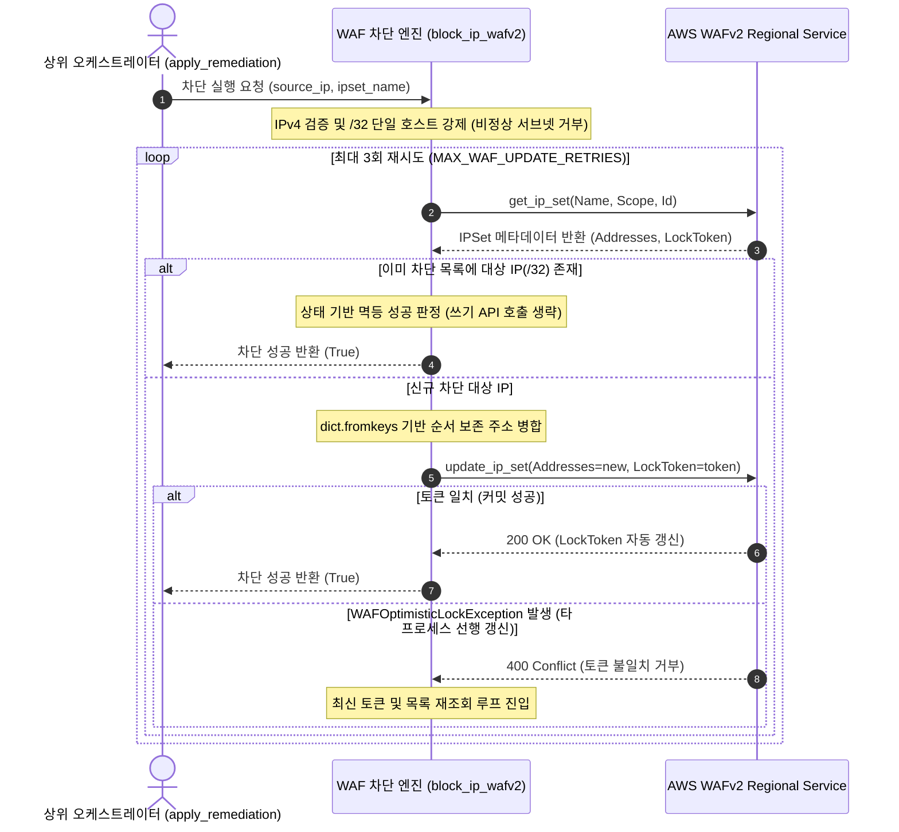

## 1. 개요 및 프로젝트 배경

이전 단계([proj-aleph-project-02-l4-ec2-quarantine-architecture](/posts/proj-aleph-project-02-l4-ec2-quarantine-architecture))에서 Boto3 기반 EC2 격리 보안 그룹 전면 교체 로직을 구축하고 AWS Stateful Connection Tracking의 동작 특성을 분석했다.

호스트 레벨의 L4 격리를 매듭짓자마자 침해사고 보고서(`IncidentReport`)의 지시어(`BLOCK_WAF`, `BLOCK_AND_QUARANTINE`, `BLOCK_IP_ONLY`)를 받아 웹 애플리케이션 길목에서 공격자 IP를 즉각 격리하는 L7 차단 엔진 구현으로 넘어갔다.

Credential Stuffing, 웹 디렉토리 스캐닝, API 무차별 대입 같은 L7 침해는 인스턴스를 통째로 네트워크에서 고립시키는 방식만으로는 해결하기 어렵다. 정상 사용자가 한창 서비스를 이용하는 도중에 서버를 내리거나 넓은 IP 대역을 막아버리면 대규모 서비스 장애로 직결되기 때문이다.

결국 정상 트래픽의 가용성을 온전히 지키면서 악성 요청을 쏟아내는 출발지 IP만 정밀하게 솎아내야 했다. Regional WAF 엣지에서 10초 안에 공격자 호스트만 핀포인트로 차단하는 원자적 엔진이 필요했던 이유다.

클라우드 A 담당자로서 외부 분산 락 인프라에 기대지 않고 AWS WAFv2의 네이티브 `LockToken`과 백오프 재시도 루프를 엮어 차단 엔진을 직접 구현했다. 서브넷 오차단을 막고 토큰 경합을 피하는 사전 상태 검사 로직도 함께 설계한 뒤, Moto 가상 WAFv2 테스트베드로 10종의 단위·통합 테스트를 완결했다.

## 2. 전체 산출물 구조 및 진단/파이프라인 체계

L7 차단 파이프라인은 상위 오케스트레이터의 지시를 받아 주소 유효성 검증, 메타데이터 조회, 인메모리 멱등성 검사, 원자적 쓰기 커밋과 충돌 재시도까지 단일 프로세스 흐름으로 완결한다.



파이프라인의 핵심은 WAF 리소스에 사전 잠금을 걸지 않는 데 있다. 최신 상태와 `LockToken`을 한 번의 호출로 가져온 뒤, 로컬 메모리에서 유효성과 멱등성을 즉각 검증한다. 쓰기 시점에 토큰을 맞춰 동시성 무결성을 챙기되, 경합이 발생해도 작업을 버리지 않고 최신 상태를 다시 읽어 최대 3회까지 자동으로 재시도한다.

WAF API 호출 과정에서 발생하는 클라이언트 예외는 함수 안에서 말끔히 격리해 `False`를 돌려준다. L4 격리나 Slack 알림 같은 뒤쪽 대응 파이프라인으로 장애가 번지지 않도록 막아두었다.

## 3. 기존 체계의 한계와 도전 과제: 분산 서버리스 환경의 갱신 분실과 광범위 차단에 따른 오차단 위험

다중 Lambda 환경에서 단순히 WAF IPSet 목록을 읽어와 새 IP를 덧붙이고 덮어쓰면 심각한 동시성 결함인 갱신 분실이 터진다. 보안 이벤트가 동시에 몰려 여러 Lambda 인스턴스가 같은 IPSet을 읽고 수정할 때, 나중에 커밋한 인스턴스가 먼저 커밋된 차단 IP를 지워버려 앞선 대응 조치가 흔적도 없이 사라지는 탓이다. 이는 차단 정책의 불일치를 일으켜 공격자의 후속 침투를 그대로 열어두는 직접적인 구멍이 된다.

공격 탐지 시스템이 넘겨주는 IP 규격을 제대로 단속하지 못할 때 생기는 폭발 반경도 치명적이었다. 단일 공격 호스트가 아니라 `/24`나 `/16` 같은 넓은 서브넷 대역이 차단 목록에 들어가면, 같은 ISP나 클라우드 NAT 게이트웨이를 쓰는 수백수천 명의 무고한 사용자까지 한꺼번에 차단되는 재해가 빚어진다. 제아무리 빠르게 막아냈더라도 정상 트래픽을 대규모로 차단한다면 가용성 측면에서는 실패한 대응이다.

반복되는 경보 때문에 이미 차단된 IP인데도 무조건 WAF 쓰기 API(`update_ip_set`)를 찌르는 구조 역시 문제였다. 불필요한 호출 비용이 새어나가는 것은 물론이고 유효한 WAF `LockToken`을 계속 갈아치우는 바람에 동시에 다른 IP를 막으려던 정상 트랜잭션들까지 연쇄적인 동시성 충돌로 휘말려 들어갔다.

## 4. 엔지니어링 의사결정 및 리팩터링

### 4.1. 외부 분산 락 배제와 WAFv2 네이티브 LockToken 기반 10초 SLA 사수

동시성 충돌을 막겠다고 흔히 쓰는 아키텍처는 Lambda 앞단에 ElastiCache Redis나 DynamoDB Lock Table 같은 중앙 분산 락 인프라를 두는 일이다. 하지만 이 길을 택하면 인프라 프로비저닝 부담에 VPC 연결 비용, 락을 쥐고 놓는 과정에서 생기는 네트워크 왕복 지연까지 고스란히 얹어진다.

CloudShield의 핵심 목표는 침해 탐지부터 대응 집행까지 10초 안에 끝내는 데 있었다. 무상태 서버리스 환경에서 무거운 중앙 락 저장소를 굴리는 구조는 10초 SLA를 맞추기에 불리할뿐더러 명백한 오버엔지니어링이었다. 그래서 외부 인프라를 과감히 덜어내고 AWS WAFv2가 기본 제공하는 `LockToken` 메커니즘을 택했다.

```python
# src/remediation/remediation.py 발췌
for attempt in range(max_retries):
    try:
        # 최신 IPSet 상세 정보 및 버전 토큰 조회
        get_res = waf_client.get_ip_set(Name=ipset_name, Scope=scope, Id=target_ipset_id)
        current_addresses = get_res.get("IPSet", {}).get("Addresses", [])
        lock_token = get_res.get("LockToken")

        # ... 중간 유효성 및 멱등성 검사 생략 ...

        # 낙관적 락 기반 원자적 갱신 호출
        waf_client.update_ip_set(
            Name=ipset_name,
            Scope=scope,
            Id=target_ipset_id,
            Addresses=new_addresses,
            LockToken=lock_token,
        )
        return True

    except ClientError as e:
        error_code = e.response.get("Error", {}).get("Code", "")
        if error_code == "WAFOptimisticLockException" and attempt < max_retries - 1:
            logger.warning("WAF 동시 수정 충돌 감지(WAFOptimisticLockException). 재시도 (%d/%d)", attempt + 1, max_retries)
            continue
        logger.error("WAF IPSet 차단 중 AWS ClientError 발생: %s", e)
        return False
```

WAFv2의 낙관적 동시성 제어는 사전에 락을 잡지 않아 평소 대기 지연이 0에 가깝다. 여러 Lambda가 동시에 쓰기를 다투다 `WAFOptimisticLockException`이 발생하더라도, 메모리에서 최신 토큰과 주소 목록을 다시 조회해 최대 3회(`MAX_WAF_UPDATE_RETRIES = 3`)까지 스스로 다시 시도하는 백오프 루프를 짰다. 외부 저장소 하나 없이도 $O(1)$ 원자성을 매끄럽게 달성했다.

재시도 루프를 설계할 때 최소한의 지수 백오프를 둘지 깊이 고민했다. 그러나 10초 관통이라는 고정 SLA 제약 아래에서는 수십 밀리초의 지연조차 누적될 경우 즉시 재시도와 큰 차이 없이 목표 시간을 위협했다.

실무 대량 트래픽 환경에 이 아키텍처를 그대로 올린다면 고정 10초라는 단일 목표에 얽매이기보다, 인입 트래픽 규모와 경합 빈도에 따라 유동적인 목표 시간을 설정하고 지수 백오프를 결합하는 고도화가 뒤따라야 할 것이다.

### 4.2. 폭발 반경 억제를 위한 엔진 레벨의 /32 엄격 검증

오차단으로 정상 서비스를 마비시키는 사고를 막으려고 입력 주소 검증과 필터링 규칙을 날카롭게 세웠다. 단일 IP가 서브넷 마스크 없이 들어오면 단일 호스트 규격인 `/32`를 자동으로 붙여 WAFv2 형식을 맞췄다.

반면 `/24`나 `/16` 같은 넓은 서브넷 대역이 들어왔을 때는 상위 파이프라인에서 복잡하게 쪼개거나 어설프게 통과시키지 않고 차단 엔진 선에서 즉각 작업을 거부(`return False`)하도록 단단한 안전장치를 걸었다.

```python
# src/remediation/remediation.py 발췌
normalized_ip = source_ip.strip()
if "/" not in normalized_ip:
    target_cidr = f"{normalized_ip}/32"
else:
    target_cidr = normalized_ip

try:
    network = ipaddress.ip_network(target_cidr, strict=False)
    if network.version != 4:
        logger.error("IPv4만 지원됩니다: %s", source_ip)
        return False
    # 단일 호스트(/32) 차단 규격 강제
    if network.prefixlen != 32:
        logger.warning("폭발 반경 방지를 위해 /32 단일 호스트 차단만 허용됩니다: %s", source_ip)
        return False
except ValueError as e:
    logger.error("유효하지 않은 IP 주소 규격: %s (%s)", source_ip, e)
    return False
```

광범위 차단 요청을 상위 오케스트레이션 단계에서 정밀 분석하여 개별 분할하는 방안도 고민해 보았으나, 10초 관통 SLA와 현 프로젝트가 다루는 위협 범위를 따져보면 엔진 레벨의 단호한 거부가 가장 안전하고 간결한 답이었다. 정상 사용자의 대규모 서비스 단절을 부를 수 있는 잠재적 위험을 시스템 최하단에서 확실히 잘라냈다.

### 4.3. 상태 기반 멱등성 검사를 통한 LockToken 연쇄 충돌 방지

보안 침해 경보가 단시간에 연이어 인입될 경우, 이미 차단된 공격자 IP에 대한 중복 조치 요청이 발생할 수 있다. 이때 무조건 WAF 쓰기 API(`update_ip_set`)를 부르면 불필요한 API 호출 비용만 축난다.

하지만 비용보다 훨씬 치명적인 문제는 `LockToken`이 불필요하게 갱신된다는 점이었다. 이미 등록된 IP 때문에 쓰기 API가 돌면서 WAF 서버의 `LockToken`이 바뀌어버리면, 마침 다른 침해 IP를 올리려던 옆 Lambda 인스턴스의 유효 토큰까지 무효화되어 연쇄 충돌(`WAFOptimisticLockException`)의 도미노가 시작된다.

```python
# src/remediation/remediation.py 발췌
# 최신 IP 목록 조회 후 인메모리 멱등성 검사
if target_cidr in current_addresses:
    logger.info("IP %s는 이미 WAF IPSet(%s)에 등록되어 있음 (멱등 처리)", target_cidr, ipset_name)
    return True

# 신규 주소 병합 시 기존 순서 보존 및 중복 제거
new_addresses = list(dict.fromkeys([*current_addresses, target_cidr]))
```

WAF 쓰기를 커밋하기 직전 `target_cidr in current_addresses` 검사를 넣어 이미 올라간 주소라면 즉시 `True`를 내주도록 만들었다. 새 주소를 합칠 때도 `dict.fromkeys`를 써서 기존 순서를 흐트러뜨리지 않고 중복 주소만 깔끔하게 걸러냈다. 헛도는 쓰기 호출을 없애면서 다른 프로세스와의 불필요한 토큰 다툼을 시작부터 지워버린 셈이다.

### 4.4. L7 핀포인트 방어선의 실무적 경계와 캡스톤 프로젝트 범위 타협

실제 운영 환경의 AWS WAFv2 IPSet은 단일 리소스에 넣을 수 있는 IP 수가 기본 10,000개로 묶여 있다. 수만 대 봇넷이 밀려드는 대규모 분산 서비스 거부 공격을 맞닥뜨리면 이런 단일 IPSet 차단은 순식간에 용량 한도(`WAFLimitsExceededException`)에 부딪혀 뻗어버린다.

이 용량 고갈을 막기 위해 DynamoDB TTL과 비동기 Lambda를 연계한 사후 해제 파이프라인 구축을 검토했으나 세 가지 기술적 근거로 기각했다.

첫째는 실시간 차단 경로와 비동기 만료 해제 경로 간의 `LockToken` 경합 위험이다. 두 프로세스가 동시에 동일한 IPSet을 갱신하면 낙관적 락 충돌이 발생하여, 10초 SLA를 사수해야 하는 실시간 차단 Lambda가 불필요한 재시도 지연을 겪게 된다.

둘째는 DynamoDB TTL의 비결정적 삭제 지연 한계다. 백그라운드 스위퍼 특성상 실제 항목 삭제와 스트림 이벤트 발행까지 최대 48시간이 소요될 수 있어 정밀한 시간 기반 격리 해제를 보장하기 어렵다.

셋째는 침해 식별 즉시 10초 내 원자적 차단이라는 캡스톤 프로젝트의 핵심 마일스톤에 집중하기 위함이었다.

수십 기가비트 규모의 볼류메트릭 트래픽은 애플리케이션 내부의 Lambda나 L7 WAF IPSet으로 감당할 대상이 아니다. 대규모 분산 공격은 서비스 앞단인 CloudFront 엣지와 AWS Shield, L4 Network ACL 같은 외곽 방어선에서 흡수해야 마땅하다.

결국 CloudShield의 L7 WAF 엔진은 출발지가 명확한 악성 요청을 엣지에서 칼같이 쳐내는 핀포인트 방어선으로 역할을 좁혔으며, 복잡한 IPSet 만료 자동화나 샤딩 같은 확장은 캡스톤 프로젝트의 시나리오 한계 안에서 영리하게 선을 긋고 타협했다.

## 5. 검증 및 회고

### 5.1. 가상 환경 기반 WAF 단위 테스트 및 동시성 재시도 검증

Moto 기반 가상 AWS WAFv2 Regional 테스트베드를 구축하여 실제 클라우드 비용 발생 없이 로컬 환경에서 10종의 단위 및 통합 테스트를 완결했다.

```python
# tests/unit/test_remediation.py 발췌
def test_block_ip_wafv2_optimistic_lock_retry(
    mocked_waf_ipset: MockWafTarget,
    monkeypatch: pytest.MonkeyPatch,
) -> None:
    """동시 수정 충돌(WAFOptimisticLockException) 발생 시 자동 재시도 후 성공 검증."""
    waf_client = boto3.client("wafv2", region_name="us-east-1")
    original_update = waf_client.update_ip_set
    call_count = 0

    def mock_update_ip_set(**kwargs):
        nonlocal call_count
        call_count += 1
        if call_count == 1:
            raise ClientError(
                error_response={"Error": {"Code": "WAFOptimisticLockException", "Message": "Conflict"}},
                operation_name="UpdateIPSet",
            )
        return original_update(**kwargs)

    monkeypatch.setattr(waf_client, "update_ip_set", mock_update_ip_set)

    success = block_ip_wafv2(source_ip="203.0.113.196", waf_client=waf_client)
    assert success is True
    assert call_count == 2
```

테스트 스위트를 통해 검증한 핵심 명세는 다음과 같다:

- `test_block_ip_wafv2_optimistic_lock_retry`: 1회차 호출 시 `WAFOptimisticLockException`을 인위적으로 유발했을 때 엔진이 예외를 포착하여 최신 상태를 Re-fetch하고 2회차에 정상 커밋함을 검증했다.

- `test_block_ip_wafv2_non_32_prefix_rejected`: `/24` 광범위 서브넷 대역 인입 시 작업을 즉각 거부하고 오차단을 차단함을 검증했다.

- `test_block_ip_wafv2_idempotent`: 동일 IP 연속 호출 시 WAF IPSet 주소 목록에 중복 등록되지 않고 멱등 처리됨을 검증했다.

- `test_atomic_remediation_success`: L4 보안 그룹 격리와 L7 WAF IP 차단이 단일 파이프라인에서 순차 완결됨을 통합 검증했다.

### 5.2. 현실적 회고 및 교훈

동시성을 다룰 때면 Redis Redlock이나 DynamoDB Lock Table 같은 무거운 저장소를 얹는 것이 정석처럼 여겨지곤 한다. 하지만 10초 관통 SLA와 서버리스 환경이라는 제약을 냉정하게 대입해 보면, 외부 저장소 도입은 레이턴시만 늘리고 운영 부담만 키우는 군더더기였다. AWS WAFv2의 네이티브 `LockToken`과 가벼운 재시도 루프를 엮어 외부 의존성 없이 $O(1)$ 원자성을 챙긴 선택은 최선의 엔지니어링 판단이었다.

실무적 이상론과 캡스톤 프로젝트의 현실 사이에서 균형을 맞추는 엔지니어링 의사결정의 타당성을 실증했다. 대규모 트래픽 방어라는 허상을 쫓다 본질을 흐리지 않고 L7 핀포인트 차단이라는 원래 목표에 집중해 구현 범위를 단단히 틀어쥐었다. 화려한 분산 기술을 덕지덕지 붙이는 것보다 주어진 SLA와 요구사항 안에서 가장 군더더기 없고 단단한 해법을 찾아내는 것이 실전 엔지니어링의 본질임을 다시 한번 확인했다.
