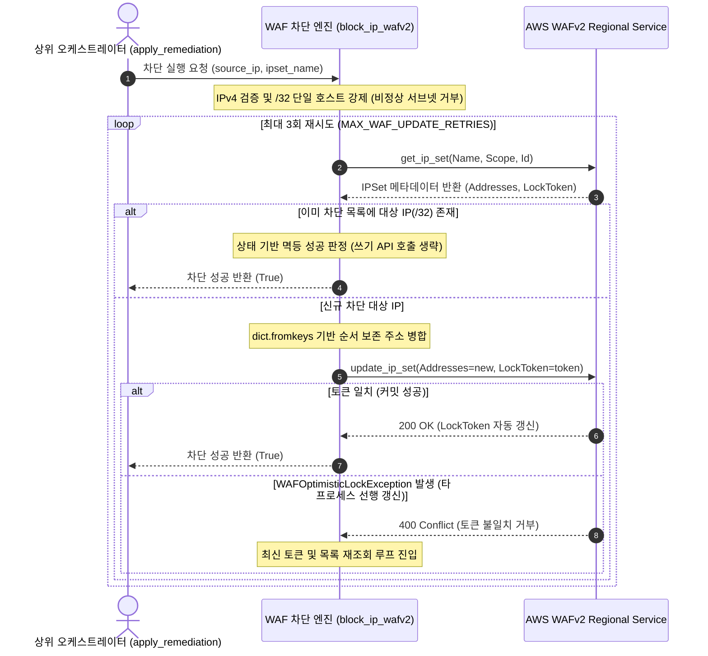

## 1. 개요 및 프로젝트 배경

이전 단계([proj-aleph-project-02-l4-ec2-quarantine-architecture](/posts/proj-aleph-project-02-l4-ec2-quarantine-architecture))에서 Boto3 기반 EC2 격리 보안 그룹 전면 교체 로직을 구축하고 AWS Stateful Connection Tracking의 동작 특성을 분석했다.

호스트 레벨의 L4 격리가 완료됨에 따라, 침해사고 보고서(`IncidentReport`)의 차단 지시어(`BLOCK_WAF`, `BLOCK_AND_QUARANTINE`, `BLOCK_IP_ONLY`)를 수신하여 웹 애플리케이션 진입로에서 공격자 IP를 즉각 격리하는 L7 차단 엔진 구현 단계로 진입했다.

Credential Stuffing, 웹 디렉토리 스캐닝, API 무차별 대입과 같은 L7 침해 위협은 인스턴스 전체를 네트워크에서 고립시키는 것만으로는 충분하지 않다. 다수의 정상 사용자가 서비스를 이용 중인 상황에서 무작정 서버를 내리거나 광범위한 IP 대역을 차단하면 대규모 서비스 장애가 유발된다.

따라서 정상 트래픽에 대한 가용성을 보장하면서 공격자의 출발지 IP만을 Regional WAF 엣지 레벨에서 10초 이내에 핀포인트로 차단하는 원자적 대응 엔진이 요구되었다.

클라우드 A 역할로서, 외부 분산 락 인프라 의존성을 배제하고 AWS WAFv2 네이티브 `LockToken` 기반의 낙관적 동시성 제어와 백오프 재시도 루프를 결합하여 차단 엔진을 직접 구현했다. 또한 서브넷 오차단 방지 및 토큰 경합을 회피하기 위한 사전 상태 검사 로직을 설계하고, Moto 가상 WAFv2 테스트베드를 통해 10종의 단위 및 통합 테스트를 완결했다.

## 2. 전체 산출물 구조 및 진단/파이프라인 체계

L7 차단 파이프라인은 상위 오케스트레이터의 지시를 수신하여 주소 유효성 검증, 메타데이터 조회, 인메모리 멱등성 검사, 원자적 쓰기 커밋 및 충돌 재시도를 단일 프로세스 흐름으로 완결한다.



파이프라인의 핵심은 WAF 리소스에 대한 사전 잠금 없이 최신 상태와 `LockToken`을 단일 호출로 취득한 뒤, 로컬 메모리에서 유효성 검증과 멱등성 검사를 즉시 수행하는 구조에 있다. 쓰기 시점에 토큰 대조를 통해 동시성 무결성을 보장하며, 경합 발생 시 작업을 폐기하지 않고 최신 상태를 재취득하여 최대 3회까지 자동 재시도한다.

모든 WAF API 호출 중 발생하는 클라이언트 예외는 함수 내부에서 격리되어 `False`로 반환되므로, L4 격리나 Slack 알림 등 후속 대응 파이프라인의 안전성을 해치지 않는다.

## 3. 기존 체계의 한계와 도전 과제: 분산 서버리스 환경의 갱신 분실과 광범위 차단에 따른 오차단 위험

다중 Lambda 환경에서 단순히 WAF IPSet 목록을 가져와 신규 IP를 추가하고 덮어쓰는 방식을 채택할 경우, 심각한 동시성 결함인 갱신 분실이 발생한다. 보안 이벤트가 동시간대에 복수로 인입되어 여러 Lambda 인스턴스가 동일한 IPSet을 동시에 읽고 가공할 경우, 늦게 커밋한 인스턴스가 먼저 커밋된 인스턴스의 차단 IP를 덮어써서 앞선 보안 조치가 증발하는 취약점이 존재했다. 이는 차단 정책의 불일치를 초래하여 공격자의 후속 공격을 허용하는 직접적인 보안 구멍이 된다.

또한 공격 탐지 시스템이 전달하는 IP 데이터의 규격이 통제되지 않을 때 발생하는 폭발 반경의 위험이 상존했다. 단일 공격 호스트가 아닌 `/24`나 `/16` 같은 광범위 서브넷 대역이 차단 목록에 무분별하게 추가될 경우, 동일 ISP나 클라우드 NAT 게이트웨이를 공유하는 수백수천 명의 무고한 정상 사용자 트래픽까지 일괄 차단되는 오차단 재해가 유발된다. 시스템이 신속하게 대응하더라도 무고한 트래픽을 대규모로 차단한다면 가용성 관점에서 치명적인 결함이 된다.

더불어 반복되는 경보로 인해 이미 차단된 IP에 대해 무조건 WAF 쓰기 API(`update_ip_set`)를 호출하는 구조는 불필요한 과금을 유발할 뿐만 아니라, 유효한 WAF `LockToken`을 지속적으로 교체시켜 동시간대에 차단을 시도하는 다른 정상 트랜잭션들까지 연쇄적인 동시성 충돌로 몰아넣는 병목 요인으로 작용했다.

## 4. 엔지니어링 의사결정 및 리팩터링

### 4.1. 외부 분산 락 배제와 WAFv2 네이티브 LockToken 기반 10초 SLA 사수

동시성 충돌을 차단하기 위한 통상적인 아키텍처는 Lambda 앞단에 ElastiCache Redis나 DynamoDB Lock Table과 같은 중앙 집중식 분산 락 인프라를 배치하는 것이다. 그러나 이 방식을 도입할 경우 추가적인 인프라 프로비저닝 오버헤드, VPC 연결 비용, 락 획득 및 해제를 위한 반복적인 네트워크 왕복 지연이 발생한다.

CloudShield의 핵심 목표는 침해 탐지부터 대응 집행까지 10초 이내에 관통하는 것이었다. 무상태 서버리스 환경에서 무거운 중앙 락 저장소를 운영하는 것은 10초 SLA 사수에 명백히 불리하며 과도한 오버엔지니어링이라고 판단했다. 따라서 외부 인프라를 전면 배제하고 AWS WAFv2가 자체 제공하는 `LockToken` 메커니즘을 채택했다.

```python
# src/remediation/remediation.py 발췌
for attempt in range(max_retries):
    try:
        # 최신 IPSet 상세 정보 및 버전 토큰 조회
        get_res = waf_client.get_ip_set(Name=ipset_name, Scope=scope, Id=target_ipset_id)
        current_addresses = get_res.get("IPSet", {}).get("Addresses", [])
        lock_token = get_res.get("LockToken")

        # ... 중간 유효성 및 멱등성 검사 생략 ...

        # 낙관적 락 기반 원자적 갱신 호출
        waf_client.update_ip_set(
            Name=ipset_name,
            Scope=scope,
            Id=target_ipset_id,
            Addresses=new_addresses,
            LockToken=lock_token,
        )
        return True

    except ClientError as e:
        error_code = e.response.get("Error", {}).get("Code", "")
        if error_code == "WAFOptimisticLockException" and attempt < max_retries - 1:
            logger.warning("WAF 동시 수정 충돌 감지(WAFOptimisticLockException). 재시도 (%d/%d)", attempt + 1, max_retries)
            continue
        logger.error("WAF IPSet 차단 중 AWS ClientError 발생: %s", e)
        return False
```

WAFv2의 낙관적 동시성 제어는 사전 잠금을 수행하지 않으므로 평상시 대기 지연이 0에 수렴한다. 다중 Lambda가 동시 쓰기를 경쟁하여 `WAFOptimisticLockException`이 발생하더라도, 인메모리에서 최신 토큰과 주소 목록을 Re-fetch하여 최대 3회(`MAX_WAF_UPDATE_RETRIES = 3`)까지 자동 재시도하는 백오프 루프를 구현함으로써 $O(1)$의 원자성을 외부 저장소 없이 달성했다.

### 4.2. 폭발 반경 억제를 위한 엔진 레벨의 /32 엄격 검증

오차단으로 인한 정상 서비스 마비를 방지하기 위해, 입력 주소에 대한 전처리 및 필터링 정책을 엄격하게 수립했다. 단일 IP가 서브넷 마스크 없이 전달되는 경우에는 단일 호스트 표기법인 `/32`로 자동 보정하여 WAFv2 규격을 충족시켰다.

반면 `/24`나 `/16` 같은 광범위 서브넷 대역이 인입되었을 때, 이를 상위 파이프라인에서 복잡하게 분할하거나 임의 허용하지 않고 차단 엔진 레벨에서 즉각 작업을 거부(`return False`)하도록 하드 가드레일을 구축했다.

```python
# src/remediation/remediation.py 발췌
normalized_ip = source_ip.strip()
if "/" not in normalized_ip:
    target_cidr = f"{normalized_ip}/32"
else:
    target_cidr = normalized_ip

try:
    network = ipaddress.ip_network(target_cidr, strict=False)
    if network.version != 4:
        logger.error("IPv4만 지원됩니다: %s", source_ip)
        return False
    # 단일 호스트(/32) 차단 규격 강제
    if network.prefixlen != 32:
        logger.warning("폭발 반경 방지를 위해 /32 단일 호스트 차단만 허용됩니다: %s", source_ip)
        return False
except ValueError as e:
    logger.error("유효하지 않은 IP 주소 규격: %s (%s)", source_ip, e)
    return False
```

광범위 차단 요청을 상위 오케스트레이션 단계에서 정밀 분석하여 개별 분할하는 대안도 고려할 수 있었으나, 10초 관통 대응 SLA와 현재 프로젝트의 위협 대응 범위를 감안할 때 엔진 단에서의 즉각 거부가 가장 안전하고 단순한 해법이었다. 정상 사용자의 대규모 서비스 단절을 초래할 수 있는 잠재적 위험을 시스템 최하단에서 원천 차단했다.

### 4.3. 상태 기반 멱등성 검사를 통한 LockToken 연쇄 충돌 방지

보안 침해 경보가 단시간에 연이어 인입될 경우, 이미 차단된 공격자 IP에 대한 중복 조치 요청이 발생할 수 있다. 이때 무조건 WAF 쓰기 API(`update_ip_set`)를 호출하면 불필요한 WAF API 호출 과금이 발생한다.

그러나 과금 절감보다 훨씬 치명적인 문제는 `LockToken`의 불필요한 갱신이었다. 이미 등록된 IP에 대해 쓰기 API를 호출하여 WAF 서버의 `LockToken`이 바뀌어버리면, 동시간대에 다른 침해 IP를 정상적으로 등록하려던 타 Lambda 인스턴스들의 유효 토큰이 무효화되어 연쇄 충돌(`WAFOptimisticLockException`)이 유발된다.

```python
# src/remediation/remediation.py 발췌
# 최신 IP 목록 조회 후 인메모리 멱등성 검사
if target_cidr in current_addresses:
    logger.info("IP %s는 이미 WAF IPSet(%s)에 등록되어 있음 (멱등 처리)", target_cidr, ipset_name)
    return True

# 신규 주소 병합 시 기존 순서 보존 및 중복 제거
new_addresses = list(dict.fromkeys([*current_addresses, target_cidr]))
```

WAF 쓰기 커밋 직전 `target_cidr in current_addresses` 검사를 수행하여 기등록 주소일 경우 즉시 `True`를 반환하도록 설계했다. 또한 신규 주소 병합 시 `dict.fromkeys`를 적용하여 기존 차단 순서를 보존하면서 중복 주소 유입을 배제했다. 이를 통해 불필요한 쓰기 호출을 생략하고 타 프로세스와의 불필요한 토큰 경합을 사전에 제거했다.

### 4.4. L7 핀포인트 방어선의 실무적 경계와 캡스톤 프로젝트 범위 타협

실제 운영 환경의 AWS WAFv2 IPSet은 단일 리소스당 등록 가능한 IP 주소 수가 기본 10,000개로 제한된다. 수만 대의 봇넷이 동원되는 대규모 분산 서비스 거부 공격이 유입될 경우, 단일 IPSet 차단 방식은 금세 용량 한도(`WAFLimitsExceededException`)에 도달하여 마비된다.

실무 엔터프라이즈 환경이라면 오래된 차단 IP를 자동 해제하는 TTL 기반 슬라이딩 윈도우 큐나 다중 IPSet 샤딩 체계가 요구될 수 있다. 그러나 이 프로젝트는 부트캠프 캡스톤 프로젝트 레벨에서 사전에 정의한 시나리오 범위(단일 공격자의 Credential Stuffing, 웹 경로 무차별 대입 및 취약점 스캐닝) 내에서 10초 이내 원자적 차단을 실증하는 데 집중했다.

근본적으로 수십 기가비트 이상의 볼류메트릭 트래픽은 애플리케이션 내부의 Lambda나 L7 WAF IPSet으로 방어할 대상이 아니다. 대규모 분산 공격은 애플리케이션 서비스 앞단인 CloudFront 엣지와 AWS Shield, L4 Network ACL 같은 최외곽 인프라 경계에서 흡수 및 분산되어야 마땅하다. 따라서 CloudShield의 L7 WAF 차단 엔진은 단일 출발지 악성 요청을 엣지에서 즉각 쳐내는 핀포인트 방어선으로 한정하였으며, 복잡한 IPSet 만료 주기 자동화나 샤딩 구조는 캡스톤 프로젝트의 시나리오 범위 내에서 명확하게 선을 긋고 타협했다.

## 5. 검증 및 회고

### 5.1. 가상 환경 기반 WAF 단위 테스트 및 동시성 재시도 검증

Moto 기반 가상 AWS WAFv2 Regional 테스트베드를 구축하여 실제 클라우드 비용 발생 없이 로컬 환경에서 10종의 단위 및 통합 테스트를 완결했다.

```python
# tests/unit/test_remediation.py 발췌
def test_block_ip_wafv2_optimistic_lock_retry(
    mocked_waf_ipset: MockWafTarget,
    monkeypatch: pytest.MonkeyPatch,
) -> None:
    """동시 수정 충돌(WAFOptimisticLockException) 발생 시 자동 재시도 후 성공 검증."""
    waf_client = boto3.client("wafv2", region_name="us-east-1")
    original_update = waf_client.update_ip_set
    call_count = 0

    def mock_update_ip_set(**kwargs):
        nonlocal call_count
        call_count += 1
        if call_count == 1:
            raise ClientError(
                error_response={"Error": {"Code": "WAFOptimisticLockException", "Message": "Conflict"}},
                operation_name="UpdateIPSet",
            )
        return original_update(**kwargs)

    monkeypatch.setattr(waf_client, "update_ip_set", mock_update_ip_set)

    success = block_ip_wafv2(source_ip="203.0.113.196", waf_client=waf_client)
    assert success is True
    assert call_count == 2
```

테스트 스위트를 통해 검증한 핵심 명세는 다음과 같다:

- `test_block_ip_wafv2_optimistic_lock_retry`: 1회차 호출 시 `WAFOptimisticLockException`을 인위적으로 유발했을 때 엔진이 예외를 포착하여 최신 상태를 Re-fetch하고 2회차에 정상 커밋함을 검증했다.

- `test_block_ip_wafv2_non_32_prefix_rejected`: `/24` 광범위 서브넷 대역 인입 시 작업을 즉각 거부하고 오차단을 차단함을 검증했다.

- `test_block_ip_wafv2_idempotent`: 동일 IP 연속 호출 시 WAF IPSet 주소 목록에 중복 등록되지 않고 멱등 처리됨을 검증했다.

- `test_atomic_remediation_success`: L4 보안 그룹 격리와 L7 WAF IP 차단이 단일 파이프라인에서 순차 완결됨을 통합 검증했다.

### 5.2. 현실적 회고 및 교훈

분산 락을 설계할 때 Redis Redlock이나 DynamoDB Lock Table 같은 무거운 외부 저장소를 도입하는 것이 당연한 모범 사례처럼 여겨지기 쉽다. 그러나 10초 관통 대응 SLA와 무상태 서버리스 환경이라는 제약 조건을 엄밀히 대입했을 때, 외부 저장소 도입은 레이턴시 지연과 운영 복잡도를 가중시키는 오버엔지니어링에 불과함을 실증했다. AWS WAFv2 API가 네이티브로 제공하는 `LockToken`과 가벼운 애플리케이션 재시도 루프를 결합하여 외부 의존성 없이 $O(1)$ 원자성을 달성한 것은 중요한 엔지니어링 의사결정이었다.

또한 실무적 이상론과 캡스톤 프로젝트 환경 사이의 경계를 명확히 인식했다. 대규모 분산 공격과 같은 트래픽 흡수를 애플리케이션 레벨의 WAF IPSet으로 해결하려 하지 않고, 핀포인트 L7 공격 차단이라는 본래 목적에 집중하여 구현 범위를 엄격히 통제했다. 화려한 분산 기술을 덧붙이는 것보다 주어진 SLA와 프로젝트 요구사항 속에서 가장 단순하고 견고한 해법을 도출하는 것이 실전 엔지니어링의 본질임을 확인했다.
