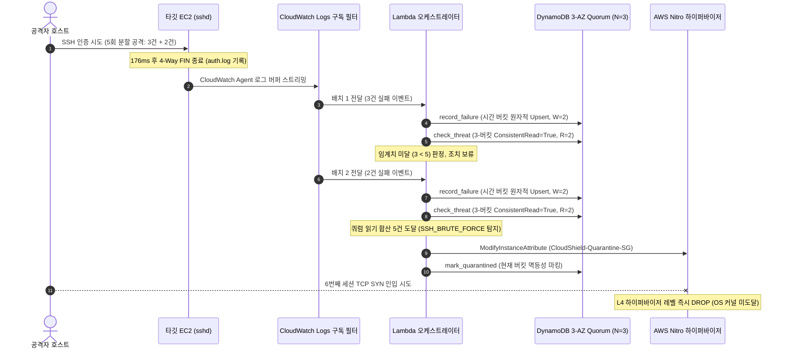

## 1. 개요 및 프로젝트 배경

이전 단계([proj-aleph-project-03-l7-wafv2-locktoken-architecture](/posts/proj-aleph-project-03-l7-wafv2-locktoken-architecture))에서 AWS WAFv2의 네이티브 `LockToken`과 백오프 재시도 메커니즘을 결합하여 공격자 IP를 10초 이내에 /32 단위로 원자적 차단하는 L7 방어 엔진을 구현했다.

L4 호스트 격리와 L7 웹 엣지 차단 수단을 확보한 직후, 파이프라인의 진입로인 탐지 및 상태 집계 계층에서 구조적 결함이 드러났다. 침해 공격을 인지하고 대응을 트리거하는 AWS CloudWatch Logs Subscription Filter가 네트워크 트래픽을 단일 이벤트가 아닌 복수의 마이크로 배치로 쪼개어 전달했기 때문이다.

AWS Lambda 런타임은 Firecracker MicroVM 내부의 격리된 주소 공간을 사용하는 Shared-Nothing 무상태 구조다. 단일 함수 메모리 내부에서만 상태를 검사하는 기존 룰 엔진은 5회 무차별 대입 공격이 3건과 2건으로 분할 인입될 경우 임계치 미달로 탐지를 100% 누락했다. 인-메모리 캐시(Redis)는 서버리스 콜드 스타트 지연과 VPC ENI 바인딩 오버헤드로 인해 10초 관통 SLA를 위협했으므로, 완전관리형 분산 키-값 저장소인 DynamoDB를 영속 상태 계층으로 선택했다.

클라우드 A 테크 리드로서 분산 환경의 시간축 왜곡, 낙관적 락(OCC) 경합으로 인한 갱신 분실, 비동기 복제에 따른 Stale Read 결함을 극복하는 슬라이딩 윈도우 엔진(`AuthFailureWindow`)을 직접 구현했다. 시간 버킷 파티셔닝 기반 락 프리 원자적 Upsert와 3-버킷 정족수 쿼럼($R + W > N$) 일관성 읽기를 설계하고, Moto 가상 환경 단위 테스트 13종을 통해 100% 무누락 탐지를 실증했다.

## 2. 전체 산출물 구조 및 진단/파이프라인 체계

분할 배치 인입 극복과 정족수 쿼럼 기반 사후 L4 격리 아키텍처는 로그 수집, 원자적 쓰기 커밋, 쿼럼 읽기 판정, Nitro 하이퍼바이저 격리까지 단일 파이프라인으로 연결된다.



## 3. 기존 체계의 한계와 도전 과제: 무상태 룰 엔진의 배치 분할 누락과 분산 동시성 경합

CloudWatch Logs Subscription Filter는 로그 볼륨(최대 1MB) 및 버퍼 전송 주기(최대 5초) 정책에 따라 동일 IP의 무차별 대입 공격 로그를 여러 개의 Lambda 호출 배치로 분할 전달한다. 단일 함수의 인-메모리 상태만 평가하는 기존 무상태 룰 엔진은 5회 임계치 공격이 3건과 2건으로 나뉘어 전달되면 두 호출 모두 임계치 미달로 판단하여 공격을 전혀 탐지하지 못하는 치명적 사각지대를 노출했다. Firecracker MicroVM 컨테이너는 요청마다 독립된 메모리 주소 공간을 사용하므로, 복수의 인스턴스가 공유할 수 있는 외부 분산 영속 계층의 도입이 불가피했다.

더욱이 패킷 분석을 통해 측정된 SSH 무차별 대입 공격의 네트워크 세션 수명은 176.109ms에 불과했다. 공격자가 3-Way Handshake를 맺고 패스워드 인증 실패 후 4-Way FIN으로 연결을 종료하기까지 걸리는 물리적 시간이 수백 밀리초에 불과한 반면, CloudWatch Agent의 버퍼링 수집과 구독 필터 전달, Lambda 기동에 소요되는 비동기 파이프라인 지연은 수 초에 달했다. 로그가 분석 엔진에 도달한 시점에 공격 세션은 이미 커널 상에서 닫혀 있었으므로, 인-세션 실시간 패킷 인터셉트(TCP RST 주입 등)는 물리적으로 성립할 수 없었다.

상태를 보존하기 위해 도입을 검토했던 단일 파티션 키 기반 낙관적 락(OCC) 모델 역시 한계를 드러냈다. 단일 키(`BF#<ip>#<user>`)에 5분 윈도우 만료 여부를 판별하는 조건부 쓰기(`ConditionExpression="expire_at >= :now"`)를 적용하자, 밀리초 단위로 동시 인입되는 Lambda 인스턴스 간에 `ConditionalCheckFailedException` 경합이 발생했다. 최대 3회의 CAS 재시도 루프가 소진되면서 일부 쓰기가 유실되는 갱신 분실과 테일 레이턴시 스파이크가 발생하여 10초 관통 SLA를 위협했다.

## 4. 엔지니어링 의사결정 및 리팩터링

### 4.1. 네트워크 세션 실측(176ms)과 사후 L4 원자적 격리의 현실적 타협

네트워크 패킷 캡처 실측 결과, 공격자의 SSH 3-Way Handshake부터 인증 실패 후 4-Way FIN 종료까지 소요된 총 세션 수명은 176.109ms였다. CloudShield 파이프라인의 로그 수집 및 Lambda 기동 지연(약 5-10초)을 고려할 때, 진행 중인 세션 내부에서 패킷을 직접 드롭하거나 TCP RST 패킷을 주입하는 인-세션 방어는 물리적으로 불가능했다.

공격자가 초당 수십 회의 고속 스크립트로 공격을 퍼붓는다면, 5회 도달 후 L4 격리가 완료되기 전인 수 초의 지연시간 동안 6-8번째 세션 역시 일시적으로 OS 커널에 도달할 수 있다. 본 아키텍처는 1회성 접속을 즉각 인터셉트하는 비현실적 이상론을 배제하고, 분할 인입되는 배치를 수 초 내에 정확히 영속 집계하여 수만 번 이어질 후속 무차별 대입의 진입로를 원천 봉쇄하는 사후 수렴 격리 모델을 확립했다.

5회 도달 즉시 타깃 EC2의 보안 그룹을 전면 차단 SG(`CloudShield-Quarantine-SG`)로 원자적 교체하면, AWS Nitro 하이퍼바이저의 vSwitch 레벨에서 6번째 이후의 모든 TCP SYN 패킷이 즉각 Drop된다. 패킷이 타깃 OS 커널(TCP 스택 및 sshd)에 도달하지 않으므로 `/var/log/auth.log` I/O 생성이 중단되고, 후속 CloudWatch 로그 수집 및 Lambda 기동 비용이 0으로 수렴하여 인프라 비용 폭탄을 방어하는 FinOps DoS 선순환 격리를 달성했다.

### 4.2. 대수의 법칙 한계 극복: 가중 추정 폐기와 락 프리 시간 버킷 파티셔닝

초기에는 Cloudflare가 제안한 슬라이딩 윈도우 카운터 추정 모델($Count = Current + Previous \times Ratio$) 도입을 검토했다. 그러나 이 알고리즘은 대규모 분산 웹 트래픽에서 대수의 법칙에 의해 시간 가중치 오차가 상쇄될 때만 유효하다. 수 초 내에 5회 시도 후 중단되는 보안 무차별 대입 공격과 같은 저빈도 버스트 트래픽에서는 가중치 근사식이 심각한 탐지 누락과 오탐을 유발하여 기각했다.

단일 키 낙관적 락(OCC)의 경합 문제를 해결하기 위해, 파티션 키 자체에 시간 버킷 ID를 내장(`epoch // 300`)하는 시간 버킷 파티셔닝 구조로 전환했다. 만료 여부를 판별하는 조건식(`ConditionExpression`)을 완전히 제거함으로써 단 1 RTT 만에 쓰기를 완결하는 락 프리 원자적 Upsert를 구현했다.

```python
# src/remediation/auth_window.py
# 시간 버킷 파티셔닝 기반 락 프리 원자적 Upsert (조건식 없는 1 RTT 커밋)
new_timestamps = [now] * count
res_bf = self._table.update_item(
    Key={"target_key": bf_key},
    UpdateExpression=(
        "ADD failure_count :inc "
        "SET timestamps = list_append(if_not_exists(timestamps, :empty), :new_ts), "
        "expire_at = :exp, last_seen = :now"
    ),
    ExpressionAttributeValues={
        ":inc": count,
        ":new_ts": new_timestamps,
        ":empty": [],
        ":exp": expire_at,
        ":now": now,
    },
    ReturnValues="ALL_NEW",
)
```

파티션 키에 `epoch // 300` 버킷을 내포시킴으로써 쓰기 경로의 동시성 락을 완전히 배제하고 충돌률 0%(재시도 0회)를 달성했다. 그 대가로 300초 슬라이딩 윈도우의 정확한 판별 책임을 쓰기 시점이 아닌 조회 시점(`check_threat`)의 3-버킷 스캔 및 타임스탬프 필터링으로 이관하는 아키텍처 트레이드오프를 단행했다.

### 4.3. 분산 복제 쿼럼(R + W > N)과 Paxos LSN 기반 1:1 동점 해소 메커니즘

DynamoDB는 3개 가용영역($N=3$)에 복제 노드를 유지하며, Paxos Leader와 1개 Follower의 과반수 쓰기($W=2$) 완료 즉시 클라이언트에 200 OK를 반환한다. 나머지 3번째 팔로워 노드는 비동기로 복제가 진행된다.

`check_threat` 조회 시 최종 일관성(`ConsistentRead=False`, $R=1$)을 사용할 경우, 복제가 지연된 3번째 노드를 읽어 방금 5회에 도달한 쓰기 상태를 놓치고 4회로 판정하는 Stale Read 결함이 발생했다. 이에 따라 읽기 시 2배의 RCU 비용을 감수하고 `ConsistentRead=True`($R=2$)를 강제하여 정족수 부등식 $W(2) + R(2) = 4 > N(3)$을 충족시켰다. 비둘기집 원리에 의해 읽기 후보 노드 2개 중 최소 1개는 최신 쓰기가 반영된 노드임이 수학적으로 보장된다.

```text
[정족수 쿼럼과 논리적 시계의 역할 분담]
- 정족수 쿼럼 (R + W > N, W=2, R=2):
  읽기 대상 노드 2개 중 최소 1개가 최신 쓰기 노드임을 물리적으로 보장하는 '그물망'
- Paxos LSN (Log Sequence Number):
  결과 집합이 [count=5, count=4]로 1:1 동점일 때 다수결 투표가 불가능하므로,
  Leader가 부여한 단조 증가 트랜잭션 번호(LSN)를 대조해 최신 데이터를 선별하는 '판별 기준'
```

읽어온 노드 응답이 최신 노드(`count=5`)와 지연 노드(`count=4`)로 나뉠 때 결과는 `[5, 4]`로 1:1 동점이 되어 값 자체의 다수결 투표가 불가능하다. 정족수 쿼럼은 최신 노드를 읽기 후보군 안에 물리적으로 가두는 그물망 역할을 수행하고, 스토리지 엔진 내부의 LSN(Log Sequence Number)과 커밋 타임스탬프가 최신 데이터를 선별하는 판별 기준 역할을 분담하여 Stale Read를 원천 차단했다.

### 4.4. 분산 큐 순서 역전 극복과 양방향 닫힌 구간 3-버킷 필터링

CloudWatch Logs 구독 필터는 단일 직렬 큐가 아닌 분산 샤딩 스트림이다. 로그 볼륨에 따라 복수의 Lambda Worker 컨테이너가 병렬 기동되며, 컨테이너 콜드 스타트 지연으로 인해 $t=299$ 이벤트를 담은 배치가 $t=450$ 이벤트를 담은 후속 배치보다 늦게 DynamoDB에 도달하는 순서 역전 현상이 발생했다.

단일 정수 카운터 시절에는 덧셈 교환법칙($A+B=B+A$)으로 순서 역전이 무해하다고 판단했으나, 시간 버킷 파티셔닝 환경에서는 버킷 ID 자체가 분할($t=450 \rightarrow$ 버킷 1, $t=299 \rightarrow$ 버킷 0)되므로 교환법칙 가설이 무너졌다. 지연 인입된 Worker가 $t=299$ 처리 시 현재(0)와 직전(-1) 버킷만 조회하면 이미 커밋된 미래 버킷(1)의 데이터를 놓쳐 탐지 누락이 발생했다.

이를 해결하기 위해 직전(`curr - 1`), 현재(`curr`), 직후(`curr + 1`) 3개 버킷을 일괄 조회하여 지연 인입 시에도 선행 커밋된 미래 버킷 데이터를 포괄하도록 설계했다. 또한 단순 하한선($t \ge now - 300$)만 둘 경우 $(t=1) \rightarrow (t=599) \rightarrow (t=301)$ 순으로 인입될 때 598초 차이나는 트래픽이 합산되는 오탐을 방지하기 위해 기준 시각 $ref$를 상한으로 하는 양방향 닫힌 구간($[ref - 300, ref]$) 필터링을 구축했다.

```python
# src/remediation/auth_window.py
# 직전/현재/직후 3-버킷 강한 일관성 읽기 및 양방향 닫힌 구간 슬라이딩 필터링
res_curr = self._table.get_item(Key={"target_key": bf_curr_key}, ConsistentRead=True)
res_prev = self._table.get_item(Key={"target_key": bf_prev_key}, ConsistentRead=True)
res_next = self._table.get_item(Key={"target_key": bf_next_key}, ConsistentRead=True)

all_ts = [int(t) for t in (item_curr.get("timestamps") or []) + 
                           (item_prev.get("timestamps") or []) + 
                           (item_next.get("timestamps") or [])]

# 기준 시각 ref 후보군에 대해 [ref - 300, ref] 닫힌 구간 내 5회 도달 여부 정밀 평가
ref_candidates = set(all_ts) | {now}
for ref_time in ref_candidates:
    cutoff_low = ref_time - self.window_seconds
    cutoff_high = ref_time
    count_in_window = sum(1 for t in all_ts if cutoff_low <= t <= cutoff_high)
    if count_in_window >= BRUTE_FORCE_THRESHOLD:
        return True, "SSH_BRUTE_FORCE", bf_curr_key
```

## 5. 검증 및 회고

### 5.1. 단위 및 동시성 테스트 검증 결과

Moto 가상 AWS 환경을 기반으로 분할 배치 누적, 동시성 경합, 순서 역전, 쿼럼 일관성을 검증하는 13종의 단위 테스트를 구현하고 전원 통과를 확인했다.

| 테스트 함수명 | 검증 시나리오 및 기술적 합격 기준 | 결과 |
|---|---|---|
| `test_split_batches_cumulative_ssh_brute_force` | 3건 + 2건 분할 배치 인입 시 누적 집계, SSH_BRUTE_FORCE 탐지 및 L4 격리 발동 | 통과 |
| `test_concurrent_record_failure_race_condition` | `ThreadPoolExecutor` 멀티스레드 동시 인입 시 원자적 카운트 보존 및 충돌 0건 | 통과 |
| `test_check_threat_uses_consistent_read` | `check_threat` 내부의 모든 버킷 조회가 `ConsistentRead=True`를 강제함을 검증 | 통과 |
| `test_out_of_order_batches_ssh_brute_force_separate_instances` | $t=450$ 선행 후 $t=299$ 지연 인입 시 3-버킷 스캔을 통한 분산 순서 역전 탐지 무결성 | 통과 |
| `test_out_of_order_upper_bound_filter_prevents_false_positive` | $(t=1) \rightarrow (t=599) \rightarrow (t=301)$ 인입 시 $t \le now$ 상한선에 의한 598초 오탐 방지 | 통과 |
| `test_remediation_idempotency_suppression` | 이미 격리 완료된 타깃에 대한 후속 실패 인입 시 중복 격리 API 호출 차단 | 통과 |

단일 게이트 스크립트 실행 결과, 전체 291개 단위 및 계약 테스트가 통과했다.

### 5.2. 현실적 회고 및 교훈

완전관리형 NoSQL 데이터베이스에서 고가용성(AP)과 일관성(CP)의 트레이드오프는 `ConsistentRead`라는 단일 클라이언트 파라미터 뒤에 은닉되어 있다. 분산 환경에서 비용 절감을 위해 관성적으로 선택하는 최종 일관성 읽기가 보안 탐지 엔진에서는 상태 누락과 공격 허용이라는 심각한 보안 결함으로 직결됨을 확인했다.

또한 대규모 웹 서비스에서 널리 활용되는 통계적 카운터 추정 알고리즘이 저빈도 버스트 보안 이벤트에서는 심각한 왜곡을 일으킨다는 기술적 결론을 도출했다. 동시성 제어를 쓰기 시점의 분산 락에 의존하지 않고 시간 버킷 파티셔닝으로 락 프리 쓰기를 달성한 뒤, 슬라이딩 윈도우의 정확성을 조회 시점의 타임스탬프 필터링으로 이관함으로써 분산 환경의 성능과 정합성을 모두 완결했다.
