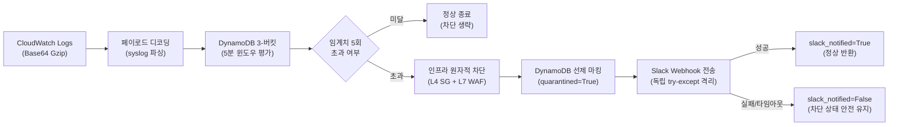

## 1. 개요 및 프로젝트 배경

이전 단계([proj-aleph-project-05-auth-window-concurrency-benchmark](/security-agent-toolkit/blog/proj-aleph-project-05-auth-window-concurrency-benchmark/))에서 시간 버킷 파티셔닝 기반 락 프리 `list_append`와 3-버킷 타임스탬프 슬라이딩 로그를 구현하여, 분할 배치 동시 인입 시의 갱신 유실과 통계적 오탐을 0건으로 통제했다.

앞서 [L4 격리기](/security-agent-toolkit/blog/proj-aleph-project-02-l4-ec2-quarantine-architecture/)와 [L7 차단기](/security-agent-toolkit/blog/proj-aleph-project-03-l7-wafv2-locktoken-architecture/), 그리고 [분산 윈도우 상태 엔진](/security-agent-toolkit/blog/proj-aleph-project-04-dynamodb-quorum-sliding-window/)을 구축했다.

이후 파편화된 개별 모듈을 단일 서버리스 Lambda 핸들러(`threat_orchestrator_handler`)로 결합하는 최종 통합 과제에 직면했다. 침해 대응 결과를 SecOps 채널에 실시간 보고하는 Slack Block Kit 카드 모듈(`send_slack_alert`)도 함께 연동해야 했다.

이 결합 과정에서 분산 시스템의 트랜잭션 비대칭성 문제가 발생했다. AWS 하이퍼바이저와 패킷 필터에 영구 반영되는 L4/L7 상태 변경 작업과, 외부 인터넷망을 경유하는 서드파티 HTTP 통지는 장애 특성과 신뢰 수준이 근본적으로 달랐다.

외부 Slack API 서버의 일시적 장애나 네트워크 패킷 유실, 소켓 타임아웃이 발생하더라도 사전에 집행된 L4/L7 인프라 차단 조치가 롤백되거나 전체 런타임이 중단되어서는 안 되었다.

클라우드 A 파이프라인 구현자로서 관제 알림 실패가 보안 방어선을 침범하지 못하도록 물리적 결함 격리 경계를 수립했다. 10초 관통 SLA를 사수하기 위한 5대 단계별 지연시간 예산 분배와 Linux 소켓 블로킹 제어, 다중 위협 배치 환경에서 엄격한 부분 실패 통제, 멱등성 기반 알림 폭풍 차단 아키텍처를 설계하여 엔드투엔드 파이프라인을 완결했다.

## 2. 전체 산출물 구조 및 진단/파이프라인 체계

단일 침해사고 인입부터 위협 판정, L4/L7 다중 계층 원자적 차단, DynamoDB 선제 격리 마킹, 그리고 외부 Slack 알림 결함 격리 경계까지의 데이터 처리 파이프라인 흐름은 다음과 같다.



## 3. 기존 체계의 한계와 도전 과제: 외부 서드파티 통지 결함의 차단 트랜잭션 결함 전파와 소켓 블로킹

개별 모듈을 단순 순차 호출로 결합할 경우, 외부 서드파티 통지 채널의 런타임 결함이 상위 보안 오케스트레이터 전체를 중단시키는 단일 실패점 결함이 발생한다. Slack Incoming Webhook은 공용 인터넷을 통과하는 단방향 HTTP POST 요청이므로 DNS 질의 실패, TLS 협상 지연, Slack 서버 5xx 장애, 속도 제한(HTTP 429) 등 통제 불가능한 네트워크 결함에 항시 노출된다.

이러한 외부 I/O 호출부를 예외 격리 없이 배치하면 Slack 전송 실패 시 발생한 예외가 상위 프로세스로 전파되어 Lambda 핸들러가 비정상 종료된다. RDBMS의 2단계 커밋(2PC)이나 Saga 패턴을 모방하여 통지 실패 시 선행 조치를 보상 트랜잭션으로 취소하도록 설계하면, 침해 호스트의 네트워크 차단이 해제되어 공격자에게 시스템이 다시 노출되는 치명적인 보안 취약점(Fail-Open)이 유발된다.

외부 장애 시의 네트워크 소켓 블로킹 현상도 10초 관통 대응 SLA를 직접적으로 위협했다. Linux 커널의 기본 TCP SYN 재전송 메커니즘은 SYN 패킷 유실 시 기본 5회 이상 지수 백오프 재전송을 수행하여 단일 소켓 연결에 최대 수십 초 이상의 블로킹을 유발한다.

서버리스 런타임에서 특정 단계의 소켓 블로킹이 수십 초간 지속되면 전체 E2E 파이프라인의 10초 SLA가 무력화된다. 이에 관제 알림 실패를 완벽히 흡수하는 결함 격리 경계를 세우고, 네트워크 I/O의 최대 지연시간을 3초 이내로 묶어두는 결정론적 타임아웃 메커니즘을 적용했다.

## 4. 엔지니어링 의사결정 및 리팩터링

### 4.1. 비대칭 트랜잭션과 보안 우선 결함 격리 경계

AWS API를 통한 인프라 상태 변경과 외부 HTTP Webhook 전송은 트랜잭션의 신뢰성과 복구 가능성 측면에서 서로 성격이 전혀 다르다. `ModifyInstanceAttribute`를 통한 격리 보안 그룹 교체와 `UpdateIPSet`을 통한 L7 차단은 AWS 패킷 필터링 계층에 영구 반영되는 필수 방어 조치다.

이 조치는 상위 프로세스에서 예외가 발생하더라도 AWS API 계층에서 자동으로 이전 상태로 되돌려주지 않는다. 반면 Slack 통지는 SecOps 담당자의 상황 인지를 돕는 관제 보조 수단에 불과하다. 보조 통지 수단의 실패가 핵심 방어선의 성공 상태를 무효화하는 것은 보안 시스템의 목적에 정면으로 위배된다.

```python
# src/remediation/orchestrator.py
target_webhook = slack_webhook_url or os.getenv("SLACK_WEBHOOK_URL")
slack_success = False
if target_webhook:
    try:
        slack_success = send_slack_alert(
            report=report,
            webhook_url=target_webhook,
            remediation_result=remediation_result,
        )
    except Exception as exc:
        logger.error("Slack 알림 전파 중 예외 발생 격리 (차단 유지): %s", exc)
        slack_success = False
```

`orchestrator.py`는 `apply_remediation` 및 DynamoDB 격리 마킹이 완료된 이후에만 `send_slack_alert`를 실행하도록 순서를 엄격히 고정했다.

호출부는 독립된 `try-except Exception` 블록으로 완전히 래핑했다. 타임아웃이나 소켓 에러가 발생하더라도 에러를 로깅하고 예외를 삼켜 상위 런타임으로의 누출을 차단했다. 인프라는 격리 상태를 유지하고 핸들러는 200 OK 응답을 정상 반환하도록 통제했다.

### 4.2. 10초 관통 SLA 완결을 위한 5대 단계별 지연시간 예산과 소켓 블로킹 제어

침해사고 인입부터 상황 전파까지 전체 파이프라인의 지연시간을 10.0초 이내로 보장하기 위해 5대 단계별 시간 예산을 엄격히 할당했다.

1단계 커널 로그 버퍼 플러시 및 CloudWatch Agent 수집에 2.0-3.0초, 2단계 서브스크립션 필터 인입에 1.0-1.5초, 3단계 DynamoDB 3-버킷 상태 평가에 0.5-1.0초, 4단계 AWS EC2 및 WAF Boto3 API 원자적 차단에 1.0-1.5초를 배정했다. 마지막 5단계 Slack Incoming Webhook 전송에는 최대 3.0초의 하드 리밋을 부여하여 누적 10.0초 이내 종료를 강제했다.

```python
# src/reporter/slack_notifier.py
start_time = time.monotonic()
for attempt in range(max_retries + 1):
    elapsed = time.monotonic() - start_time
    remaining_budget = timeout - elapsed
    if remaining_budget <= 0:
        return False
    req_timeout = timeout if (attempt == 0 and elapsed < 0.05) else remaining_budget
    try:
        req = urllib.request.Request(url=webhook_url, data=encoded_data, method="POST")
        with urllib.request.urlopen(req, timeout=req_timeout) as response:
            if getattr(response, "status", None) == 200:
                return True
    except TimeoutError:
        return False
```

외부 네트워크 장애 발생 시 Linux 커널의 TCP SYN 재전송 루프로 인한 소켓 고착을 방지하기 위해 `monotonic clock` 기반 실시간 예산 추적 알고리즘을 구현했다.

매 재시도 루프마다 경과 시간을 측정하여 남은 예산(`remaining_budget`)을 동적 계산했다. `urllib.request.urlopen`의 `timeout` 파라미터에 잔여 예산을 주입함으로써 단일 소켓 I/O가 3.0초를 초과하여 파이프라인 전체를 블로킹하는 현상을 원천 방어했다.

### 4.3. 다중 위협 배치 환경의 slack_notified 반환 규격과 all() 엄격 통제

단일 CloudWatch Logs 페이로드 내에 복수의 IP 또는 복수의 공격 벡터(예: 동일 IP의 무차별 대입과 패스워드 스프레잉 동시 인입)가 포함될 경우, 복수의 위협이 단일 배치에서 동시 식별된다. 이때 오케스트레이터의 반환 규격에서 알림 성공 여부를 단일 불리언 값으로 어떻게 표현할 것인가에 대한 정합성 문제가 대두되었다.

임의의 1건이라도 성공했을 때 `True`를 반환하는 느슨한 조건을 적용하면, 일부 위협 통지가 누락되었음에도 관제 대시보드나 CloudWatch Metric이 전건 정상 통지로 오인하는 관제 사각지대가 발생한다.

```python
# src/remediation/orchestrator.py
    slack_notification_results.append(slack_success)

if slack_notification_results:
    response["slack_notified"] = all(slack_notification_results)
else:
    response["slack_notified"] = False

return response
```

단 1건의 알림 누락도 SecOps 관제 실패로 규정하도록 Python 내장 `all()` 검증 로직을 적용했다.

배치 내에서 탐지된 모든 위협에 대해 Slack 카드가 100% 정상 전송된 경우에만 `slack_notified = True`를 반환했다. 1건이라도 실패하거나 타임아웃된 경우 즉시 `False`를 반환하도록 설계하여 상위 관제 시스템이 부분 실패 상태를 인지하고 후속 조치를 취할 수 있도록 보장했다.

### 4.4. 원자적 격리 마킹(quarantined=True)을 통한 멱등성 보장 및 알림 폭풍 원천 차단

무차별 대입 공격은 짧은 시간 동안 대량의 실패 로그를 발생시킨다. 이미 L4/L7 차단이 집행되었음에도 CloudWatch Logs 파이프라인 상에 잔류하던 후속 실패 로그 배치가 수 초 간격으로 연속 인입된다.

후속 이벤트 인입 시마다 오케스트레이터가 Boto3 차단 API를 재호출하고 Slack 알림을 재전송하면 AWS API Throttling이 발생할 뿐만 아니라 SecOps 채널로의 연쇄 알림 쇄도가 초래된다.

```python
# src/remediation/orchestrator.py
if is_remediation_successful(action_required, remediation_result):
    auth_window.mark_quarantined(target_key)
    logger.info("위협 대응 완료 및 격리 마킹 성공: %s -> %s", rule_name, source_ip)
else:
    logger.warning("위협 대응 필수 조치 미완료로 격리 마킹 생략: %s -> %s", rule_name, source_ip)
```

`is_remediation_successful()` 헬퍼 함수를 통해 요구된 필수 차단 조치(`quarantine_applied` 및 `waf_blocked`)가 실제로 성공했는지를 사전 검증했다.

검증 통과 즉시 DynamoDB 현재 버킷 레코드에 `quarantined = True`를 선제 마킹했다. 후속 배치가 인입되면 `auth_window.check_threat()`가 DynamoDB 3-버킷의 `quarantined` 플래그를 읽어 위협 판정을 즉시 비활성화(`is_threat = False`)했다.

불필요한 중복 Boto3 호출과 Slack 카드 폭풍을 방지하면서, 차단 조치가 미완료된 경우에는 마킹을 생략하여 차기 인입 이벤트에서 안전하게 재시도되도록 보장했다.

## 5. 검증 및 회고

### 5.1. 가상 환경 기반 통합 파이프라인 및 결함 격리 단위 테스트 검증

구현한 오케스트레이터 파이프라인의 종단 무결성과 결함 격리 특성을 증빙하기 위해 `tests/unit/test_remediation.py`에 포괄적인 단위 테스트 슈트를 구축하고 검증을 완결했다.

첫째, `test_threat_orchestrator_slack_integration_success` 테스트를 통해 5회 실패 로그 인입 시 L4 SG 격리 및 L7 WAF 차단 성공과 함께 `slack_notified = True`가 정상 반환됨을 확인했다. 둘째, `test_threat_orchestrator_slack_failure_fault_isolation` 테스트를 통해 Slack Webhook 호출 시 `RuntimeError` 예외가 발생하더라도 `slack_notified = False`만 반환될 뿐 실제 인스턴스의 격리 SG 상태와 WAF IPSet 차단 목록이 안전하게 유지됨을 실증했다.

셋째, `test_threat_orchestrator_slack_no_webhook_url` 및 `test_threat_orchestrator_slack_env_var_fallback` 테스트를 통해 환경 변수 미설정 시의 무장애 통과와 우선순위 폴백 동작을 확인했다. 넷째, 격리 마킹 직후 동일 타깃 공격에 대해 `auth_window.check_threat()`가 `False`를 반환함으로써 중복 차단 시도가 원천 억제됨을 증빙했다.

### 5.2. 현실적 회고 및 교훈

보안 오케스트레이션(SOAR) 시스템 설계에서 관제용 통지 채널과 인프라 방어선 간의 비대칭 트랜잭션 경계를 물리적으로 분리해야 하는 당위성을 실증했다. 분산 트랜잭션의 일반적인 접근법인 보상 트랜잭션이나 롤백 메커니즘을 보안 도메인에 맹목적으로 차용할 경우, 서드파티 통지망의 장애가 침해 시스템을 방치하는 치명적인 보안 역설(Fail-Open)을 초래한다는 기술적 결론을 도출했다.

외부 네트워크 I/O를 포함하는 서버리스 아키텍처에서는 Linux 커널의 기본 소켓 동작 방식까지 정밀하게 통제해야 10초 관통 대응 SLA를 사수할 수 있음을 확인했다. 커널의 기본 TCP SYN 재전송 동작을 방치할 경우 서버리스 핸들러의 실행 시간 상한 전체가 잠식될 수 있음을 규명하고, 시간 예산 기반의 엄격한 타임아웃 통제로 결정론적 최대 지연시간을 달성했다.

단일 배치 내 복수 위협에 대한 `all()` 기반 부분 실패 판정과 DynamoDB 선제 격리 마킹을 결합함으로써, 침해사고 대응의 신뢰성과 멱등성을 동시에 확보하는 서버리스 보안 오케스트레이터 파이프라인을 완결했다.
