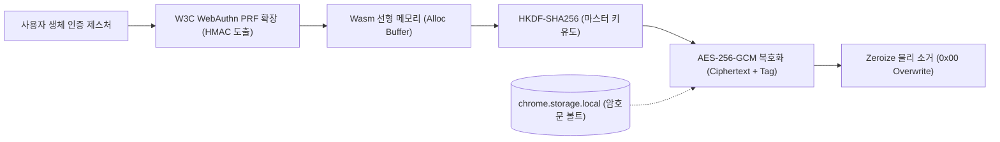

# PrfVault 1편: W3C WebAuthn PRF와 Rust Wasm 코어 암호 엔진 설계

> 중앙 인증 서버에 일체 의존하지 않는 Zero-Server 아키텍처 환경에서 W3C WebAuthn Level 3 PRF 확장과 Rust WebAssembly의 선형 메모리 물리 소거를 결합하여 하드웨어 바인딩 로컬 볼트 암호 코어를 구축한 엔지니어링 기록입니다.

---

## 1. 개요 및 학습 개념 요약

대학 포털을 비롯한 국내 레거시 웹 환경은 여전히 멀티팩터 인증(MFA) 없는 단일 비밀번호 체제로 운영되고 있습니다. 사용자는 복잡한 문자열을 다수 암기할 수 없어 취약한 암호를 반복 재사용하며 이 습관은 크리덴셜 스터핑 공격의 주요 침투 경로로 악용됩니다.

상용 패스워드 매니저는 암호화된 볼트를 중앙 클라우드 서버에 동기화하지만 중앙 집중식 저장소는 단 한 번의 서버 침해로 전 사용자의 볼트 데이터베이스가 유출될 수 있는 단일 실패점(SPOF) 리스크를 안고 있습니다.

PrfVault는 외부 서버 통신을 원천 배제한 상태에서 브라우저 확장프로그램이 사용자 PC의 하드웨어 보안 모듈(TPM 2.0 또는 FIDO2 인증자)만을 유일한 신뢰 기준점으로 삼도록 설계했습니다. 타 기기와의 원격 동기화가 불가능하다는 제약은 마스터 비밀키를 저장한 외장 보안키(USB)로 대체한다는 전제를 세웠습니다.

W3C WebAuthn Level 3 명세에 포함된 PRF(Pseudo-Random Function) 확장은 인증자가 보유한 비밀키와 솔트 값을 HMAC 연산하여 결정론적인 256비트 대칭 엔트로피를 브라우저로 직접 반환합니다. 이 엔트로피를 바탕으로 Rust WebAssembly 환경에서 HKDF 키 파생 및 AES-256-GCM 복호화를 단독 수행하여 서버 침해 표면을 물리적으로 제거한 로컬 완결형 볼트를 구현했습니다.

---

## 2. 전체 산출물 구조 및 진단/파이프라인 체계

PrfVault 코어 암호 파이프라인은 브라우저의 사용자 제스처 이벤트에서 출발하여 W3C WebAuthn 확장 호출, Rust Wasm 선형 메모리 버퍼 제어, 로컬 스토리지 I/O로 이어지는 단방향 데이터 흐름을 따릅니다.



파이프라인의 핵심은 웹 표준 API(`navigator.credentials.get`)가 반환한 하드웨어 바인딩 시드를 자바스크립트 힙에 문자열 형태로 보관하지 않고 즉시 Rust Wasm의 독립된 선형 메모리(`WebAssembly.Memory`)로 전달하는 것입니다.

복호화 연산이 완결된 직후에는 선형 메모리 영역에 대해 휘발성 덮어쓰기(`zeroize`)를 강제 실행하여 메모리 덤프 공격에 대응합니다.

---

## 3. 기존 체계의 한계와 도전 과제: TOTP 엔트로피 붕괴와 V8 힙 잔류 결함

초기 아키텍처 구상 단계에서는 별도 하드웨어 없이 모바일 기기 앱으로 생성할 수 있는 TOTP(RFC 6238)를 2차 인증 및 마스터 키 유도 수단으로 검토했습니다. 그러나 TOTP는 6자리 10진수 정수로 표현되므로 정보 엔트로피가 약 19.93 bits에 불과합니다.

만약 이 값을 시드로 삼아 볼트를 암호화한다면 인포스틸러 악성코드가 로컬 디스크(`chrome.storage.local`)의 암호문 블록을 탈취했을 때 100만 개 경우의 수를 오프라인 브루트포스로 대입하여 수 밀리초 만에 암호키를 역산할 수 있는 치명적 보안 결함이 발생합니다. 또한 TOTP는 시각 기반의 단방향 인증 티켓일 뿐 256비트 대칭 암호화 키를 안전하게 도출하는 KDF 메커니즘으로 기능할 수 없었습니다.

한편 브라우저 런타임 레이어에서는 자바스크립트 V8 엔진의 문자열 불변성과 가비지 컬렉터의 비결정적 지연이 근본적인 한계로 작용했습니다. Wasm 선형 메모리 내부에서는 결정론적인 소거가 가능하더라도 복호화된 평문 비밀번호가 웹페이지 DOM 입력창에 주입되는 순간 자바스크립트 힙에 복사본이 생성되는 현상은 설계 단계부터 예견된 플랫폼 제약이었습니다. 전체 볼트 평문을 메모리에 들고 있는 방식을 배제하고 평문 노출 시간을 수학적·시간적으로 극소화하는 방어 전략을 세워야 했습니다.

---

## 4. 엔지니어링 의사결정 및 리팩터링

### 4.1. W3C WebAuthn Level 3 PRF 확장을 통한 256비트 하드웨어 엔트로피 도출

브라우저 표준 계층에서는 외장 보안키나 내장 인증자에 등록된 자격증명 ID와 32바이트 솔트를 조합하여 PRF 확장을 요청하도록 클라이언트를 구축했습니다.

```typescript
// extension/src/auth/webauthn-prf.ts
const assertion = await navigator.credentials.get({
  publicKey: {
    challenge: new Uint8Array(32),
    rpId: window.location.hostname,
    allowCredentials: [{
      id: base64UrlDecode(savedCredentialId),
      type: "public-key"
    }],
    userVerification: "required",
    timeout: 60000,
    extensions: {
      prf: { eval: { first: lastSalt } },
      hmacGetSecret: { salt1: lastSalt }
    }
  }
}) as PublicKeyCredential;
```

`userVerification: "required"`를 강제하여 사용자 지문이나 PIN 입력 없는 무단 키 파생을 원천 차단했습니다. 또한 최신 브라우저 표준인 `prf` 확장과 레거시 FIDO2 명세인 `hmacGetSecret`을 이중 질의하도록 구성하여 인증자 펌웨어 파편화에 대응했습니다.

### 4.2. Rust Wasm 선형 메모리 할당 및 zeroize 기반 휘발성 물리 소거

자바스크립트 가비지 컬렉터의 간섭을 배제하고 메모리 생명주기를 결정론적으로 제어하기 위해 암호 코어 전체를 Rust로 작성하고 C-ABI FFI 인터페이스를 노출했습니다.

```rust
// crates/crypto-core/src/lib.rs
#[unsafe(no_mangle)]
pub unsafe extern "C" fn prf_vault_dealloc_zeroize(ptr: *mut u8, size: usize) {
    if ptr.is_null() || size == 0 {
        return;
    }
    unsafe {
        let slice = std::slice::from_raw_parts_mut(ptr, size);
        slice.zeroize();
        let boxed = Box::from_raw(slice as *mut [u8]);
        drop(boxed);
    }
}
```

`slice.zeroize()`는 컴파일러의 Dead Store Elimination 최적화로 인해 메모리 초기화 루틴이 제거되는 현상을 방지하고 메모리 버퍼에 `volatile write`를 수행하여 모든 바이트를 0x00으로 소거한 뒤 메모리를 회수합니다.

### 4.3. HKDF-SHA256 마스터 키 유도와 바이너리 와이어 레이아웃 동결

하드웨어 PRF 출력값(32바이트)을 암호화 키로 직접 사용하는 것은 권장되지 않으므로 고유 컨텍스트 라벨을 포함한 HKDF-Expand 단계를 거쳐 256비트 마스터 키를 도출했습니다.

```rust
// crates/crypto-core/src/lib.rs
let hk = Hkdf::<Sha256>::new(Some(salt), prf_output);
let mut okm = [0u8; 32];
if hk.expand(HKDF_INFO, &mut okm).is_err() {
    return ERR_HKDF_FAILED;
}

unsafe {
    std::ptr::copy_nonoverlapping(okm.as_ptr(), out_key_ptr, 32);
}
okm.zeroize();
```

영속화 볼트 포맷은 모호한 JSON 직렬화 대신 헤더 파싱 공격을 방지할 수 있는 바이너리 와이어 레이아웃으로 동결했습니다:
- **버전 식별자 (2바이트):** `0x0001` (스키마 불일치 감지)
- **볼트 솔트 (32바이트):** HKDF 및 PRF 입력용 고유 엔트로피
- **초기화 벡터 Nonce (12바이트):** AES-GCM 표준 난수
- **암호문 길이 필드 (4바이트):** 빅엔디안 무결성 검증
- **암호문 페이로드 ($N$ 바이트):** AES-256-GCM 암호문
- **인증 태그 (16바이트):** 변조 방지 폴리노미얼 MAC

### 4.4. 온디맨드 단일 계정 복호화 기반 V8 힙 노출 창 극소화

전체 볼트를 메모리에 복호화하여 상주시키는 상용 확장프로그램 구조를 배제하고 Content Script가 로그인 폼 포커스를 감지했을 때 오직 해당 도메인에 바인딩된 단 1개의 자격증명만 요청하는 온디맨드 프로토콜을 구축했습니다.

Wasm에서 평문 도출 후 DOM 값 설정 및 이벤트 디스패치를 완료한 직후 스코프를 즉시 닫아 평문 참조를 끊었습니다. 이를 통해 수백 개 계정 정보가 프로세스 메모리에 상주하는 위험을 차단하고 평문이 힙 메모리에 머무르는 노출 창을 단일 계정의 주입 순간인 수 밀리초 단위로 압축했습니다.

---

## 5. 검증 및 회고

### 5.1. 가상 인증자 E2E 통과와 로컬 실기 하드웨어 차단 실증

Phase 1 Spike 단계에서는 무인 자동화 검증과 로컬 실기 검증을 순차 수행했습니다.

| 검증 단계 | 검증 환경 및 대상 | 검증 시나리오 | 결과 |
| :--- | :--- | :--- | :---: |
| **코어 엔진 단위 검증** | Rust `cargo test` (17건) | FFI 널 포인터, HKDF 키 파생, AES-GCM 무결성, Zeroize 소거 | **전수 통과** |
| **CDP 가상 인증자 검증** | Chromium DevTools Protocol (`hasPrf: true`) | 무인 E2E 환경에서 PRF 32B 시드 도출 및 볼트 암복호화 완결 | **성공 (PASS)** |
| **로컬 실기 하드웨어 검증** | Windows 11 + Intel 10세대 PTT TPM 2.0 | 실제 브라우저에서 내장 Windows Hello 생체 인증자 호출 | **명시적 거부** |

```powershell
PS C:\work\security-agent-toolkit\.cache\repos\prfvault> cargo test -p crypto-core
running 17 tests
test tests::test_null_pointer_handling ... ok
test tests::test_hkdf_derivation_deterministic ... ok
test tests::test_aes_gcm_encrypt_decrypt_roundtrip ... ok
test tests::test_tampered_ciphertext_fails_tag ... ok
test tests::test_zeroize_memory_clearing ... ok
test result: ok. 17 passed; 0 failed; 0 ignored
```

가상 인증자 에뮬레이션 환경에서는 PRF 호출부터 Wasm 복호화까지 100% 정상 동작을 확인했습니다. 그러나 당일 오후 Windows 11 실기 환경에 탑재하여 내장 TPM 2.0 인증자를 호출한 직후, 운영체제 계층(`webauthn.dll`)이 `{hmacCreateSecret: false, prf: {enabled: false}}`를 반환하며 웹 표준 인터페이스를 일방적으로 폐쇄하는 현상에 직면했습니다.

### 5.2. 현실적 회고 및 교훈

가상 인증자 환경의 성공은 개발자에게 완벽한 시스템을 구축했다는 착시를 주었으나 실제 소프트웨어는 운영체제와 하드웨어 드라이버가 쥐고 있는 권한 계층의 직접적인 지배를 받는다는 냉혹한 현실을 실증했습니다.

W3C 명세서상 완전한 웹 표준이라도 OS 플랫폼이 이를 노출하지 않으면 브라우저 샌드박스 내부에서는 아무것도 할 수 없었습니다. 이 실패는 단순한 개발 중단으로 이어지지 않고 웹 표준 실패를 감지하는 즉시 운영체제 내장 TPM 2.0 엔클레이브를 직접 호출하는 2편의 'Windows CNG Native Messaging Host 하이브리드 폴백' 아키텍처로 진화하는 결정적 계기가 되었습니다.
