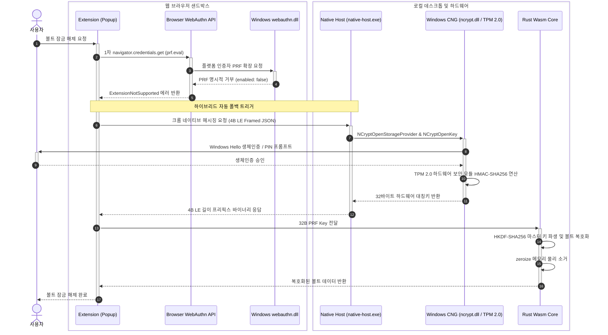

## 1. 개요 및 프로젝트 배경

1편에서는 W3C WebAuthn Level 3 PRF 확장과 Rust WebAssembly 코어를 결합하여 외부 서버 없는 로컬 볼트 암복호화 엔진을 구축했다. 가상 인증자 환경에서는 사용자 생체 인증을 거쳐 256비트 대칭키를 유도하고 볼트를 복호화하는 과정이 정상 동작했다.

그러나 개발 검증용 가상 환경을 벗어나 데스크톱 실기 하드웨어에 탑재한 순간 운영체제 계층의 인터페이스 차단이라는 제약에 직면했다. 브라우저는 PRF 확장을 지원한다고 응답했으나, 운영체제 계층이 하드웨어 보안 모듈 연동을 거부하며 빈 결과값을 반환했다.

시중의 고가 외장 보안키를 별도 구매하지 않은 일반 데스크톱 사용자는 브라우저 표준 API만으로 로컬 볼트를 열 수 없었다. 이 플랫폼 결함을 해결하기 위해 웹 표준 호출 실패 시 즉시 운영체제 내장 TPM 2.0 칩을 직접 호출하는 네이티브 폴백 파이프라인을 설계했다.

브라우저와 로컬 프로그램을 연결하는 크롬 네이티브 메시징 규약으로 프로세스를 띄우고, 외부 의존성 없는 Rust C-FFI로 Windows CNG 시스템 API를 직접 호출했다. Windows Hello 인증과 연동된 TPM 2.0 보안 칩에서 256비트 대칭키를 직접 유도하는 하이브리드 아키텍처를 구축했다.

---

## 2. 전체 산출물 구조 및 진단/파이프라인 체계

하이브리드 키 도출 체계는 웹 표준 1차 호출 실패를 감지한 직후 크롬 네이티브 메시징 IPC를 거쳐 Windows CNG로 전환되는 자동 폴백 흐름을 따른다.



브라우저가 마더보드의 물리 칩을 직접 제어할 수 없으므로, 로컬 실행 파일이 운영체제 시스템 라이브러리를 거쳐 TPM 2.0 칩과 통신하도록 역할을 분담했다.

도출된 32바이트 대칭키는 표준 PRF 출력과 동일한 규격으로 Rust Wasm 코어에 전달되어 단일한 HKDF-SHA256 파이프라인으로 처리된다.

---

## 3. 기존 체계의 한계와 도전 과제: webauthn.dll의 PRF 거부와 플랫폼 불일치

Phase 1 Spike 단계에서 구축한 WebAuthn PRF 클라이언트를 실제 데스크톱 환경(Intel Core i5-10400, Intel PTT TPM 2.0, Windows 11 Build 26200.0, `webauthn.dll`, Chrome/Edge 153)에 연결하여 실기 테스트를 진행했다. 1차 테스트에서는 브라우저가 플랫폼 인증자 요청을 가로채 Google 비밀번호 관리자 팝업을 띄우며 빈 객체 `{"prf": {}}`를 반환했다.

2차 테스트에서 Windows Hello를 명시 지정하고 4자리 OS PIN을 통과했으나 `{"prf": {"enabled": false}}`가 반환되며 확장이 차단되었다. 3차로 `residentKey: "required"`와 Salt를 사전 바인딩했으나 거부 결과는 변하지 않았다.

4차 테스트에서 구형 TPM 친화 알고리즘인 `RS256 (-257)`을 1순위로 선언하고 CTAP 2.0 `hmacCreateSecret: true` 플래그를 병행 주입했다. 브라우저는 Capabilities 질의에서 두 확장을 모두 지원한다고 응답했으나, 운영체제 인증자는 `{"hmacCreateSecret": false, "prf": {"enabled": false}}`를 반환하며 대칭키 유도 확장을 지원하지 않았다.

계층별 원인을 규명한 결과 하드웨어와 브라우저에는 결함이 없었다. Intel PTT TPM 2.0은 TCG 표준 `TPM2_HMAC` 명령을 내장하고 있었으며 Chromium 153 브라우저 역시 PRF 파이프라인을 온전히 활성화한 상태였다.

병목 지점은 Windows 운영체제의 `webauthn.dll` 모듈이었다. Windows OS는 USB 포트에 꽂는 외장 보안키에는 `hmac-secret` 처리를 허용하지만, 데스크톱 내장 TPM을 사용하는 플랫폼 인증자에 대해서는 브라우저 API 레벨에서 대칭키 유도 확장을 개방하지 않고 강제로 비활성화했다.

글로벌 패스워드 매니저인 Bitwarden의 공식 이슈(Issue #19858)에서도 동일한 플랫폼 레벨의 구조적 결함이 보고되었다. Bitwarden 분석에 따르면 Windows Hello 플랫폼 인증자는 Windows 11 환경에서도 PRF 확장에 대해 일관되게 `Encryption not supported` 오류를 반환한다.

이로 인해 상용 서비스조차 패스키 기반 자동 볼트 잠금 해제를 포기하고 마스터 패스워드 입력으로 폴백 처리하는 실정이었다. 웹 표준 단독 구현에 의존해서는 외장 보안키 없는 일반 PC 환경에서 제로 서버 로컬 볼트를 성립시킬 수 없다는 기술적 결론을 도출했다.

---

## 4. 엔지니어링 의사결정 및 리팩터링

### 4.1. 브라우저 PRF 거부 감지 및 크롬 네이티브 메시징 투명 폴백 파이프라인

웹 표준이 차단되었다고 해서 네이티브 단독 구조로 축소하지 않았다. 외장 보안키를 연결하거나 향후 운영체제 업데이트로 기능이 개방될 가능성에 대비하여 1차 진입점은 W3C WebAuthn PRF 호출을 유지했다.

브라우저 표준 호출에서 예외가 발생하거나 `prf.enabled === false`가 반환되면 catch 블록에서 즉시 로컬 호스트 프로세스를 호출하는 이중화 클라이언트를 구현했다.

```typescript
// extension/src/auth/webauthn-prf.ts
export async function deriveMasterKeyWithFallback(
  domain: string,
  salt: Uint8Array,
  credentialId?: string,
  cryptoCore?: CryptoCore
): Promise<HybridKeyDerivationResult> {
  const core = await getOrCreateCryptoCore(cryptoCore);
  let prfSecret: Uint8Array | null = null;
  let provider: 'webauthn' | 'native_host' = 'webauthn';

  try {
    prfSecret = await derivePrfSecret(credentialId, salt, domain);
    provider = 'webauthn';
  } catch (webauthnErr) {
    provider = 'native_host';
    const hostResult = await derivePrfViaHost(domain, toHex(salt));
    if (!hostResult?.derived || !hostResult.key) {
      throw new Error('하이브리드 키 도출 실패: WebAuthn 및 Native Host 모두 실패');
    }
    prfSecret = fromHex(hostResult.key);
  }

  const masterKey = core.deriveMasterKey(prfSecret, salt);
  return { masterKey, provider };
}
```

`deriveMasterKeyWithFallback` 함수는 브라우저 표준 WebAuthn 호출 실패 시 크롬 네이티브 메시징 API(`chrome.runtime.sendNativeMessage`)를 호출한다.

확장 프로그램 백그라운드 Service Worker와 네이티브 호스트(`com.prfvault.native_host`) 간 통신에는 5,000ms 제한시간 타이머를 적용하여 프로세스 응답 지연으로 인한 Promise 누수를 차단했다.

### 4.2. 외부 크레이트 의존성을 배제한 Windows CNG(ncrypt.dll) C-FFI 직접 바인딩과 RAII 자원 관리

네이티브 호스트 프로세스는 Windows 운영체제 암호화 코어인 CNG API를 호출해야 했다. 수많은 Windows API 라이브러리를 통째로 가져오는 대신 필요한 6대 함수 심볼과 구조체만을 Rust 기본 FFI로 직접 선언했다.

`windows-sys` 크레이트조차 의존성 목록에서 제외하고 필요한 Win32 네이티브 API 함수와 버퍼 구조체(`NCryptBufferDesc`, `NCryptBuffer`)만을 바인딩하여 바이너리 크기를 줄이고 외부 공급망 위험 노출을 최소화했다.

```rust
// crates/native-host/src/windows_hello.rs
#[cfg(target_os = "windows")]
#[link(name = "ncrypt")]
unsafe extern "system" {
    fn NCryptOpenStorageProvider(phProvider: *mut usize, pszProviderName: *const u16, dwFlags: u32) -> i32;
    fn NCryptFreeObject(hObject: usize) -> i32;
    fn NCryptOpenKey(hProvider: usize, phKey: *mut usize, pszKeyName: *const u16, dwLegacyKeySpec: u32, dwFlags: u32) -> i32;
    fn NCryptCreatePersistedKey(hProvider: usize, phKey: *mut usize, pszAlgId: *const u16, pszKeyName: *const u16, dwLegacyKeySpec: u32, dwFlags: u32) -> i32;
    fn NCryptFinalizeKey(hKey: usize, dwFlags: u32) -> i32;
    fn NCryptDeriveKey(hKey: usize, pszKDF: *const u16, pParameterList: *const NCryptBufferDesc, pbDerivedKey: *mut u8, cbDerivedKey: u32, pcbResult: *mut u32, dwFlags: u32) -> i32;
}

struct SafeProviderHandle(usize);
impl Drop for SafeProviderHandle {
    fn drop(&mut self) {
        if self.0 != 0 { unsafe { NCryptFreeObject(self.0) }; }
    }
}
```

Win32 C-API 호출 시 핸들을 닫지 않아 발생하는 OS 메모리 누수를 방지하기 위해 RAII 패턴 래퍼 구조체 `SafeProviderHandle`과 `SafeKeyHandle`을 정의했다.

함수 실행 중 에러가 발생하여 조기 반환되거나 스택 언와인딩이 일어나더라도 `Drop` 트레이트가 `NCryptFreeObject`를 기계적으로 호출하여 OS 메모리 핸들을 즉시 회수한다.

### 4.3. Windows Hello 생체 인증 트리거 및 TPM 2.0 KSP 기반 HMAC-SHA256 대칭키 유도

운영체제 TPM 2.0 프로바이더 접근 시 우선순위를 설정했다. 1순위로 Windows Hello 생체 인증 및 PIN을 담당하는 `Microsoft Passport Key Storage Provider`를 호출하고, 실패 시 2순위로 플랫폼 TPM 전용 프로바이더인 `Microsoft Platform Crypto Provider`를 탐색했다.

도메인별로 격리된 영속 키(`PrfVault_{domain}`)를 탐색한 후 존재하지 않을 경우 타원곡선 `ECDSA_P256` 키 페어를 신규 생성하여 TPM KSP에 영속화했다.

```rust
// crates/native-host/src/windows_hello.rs
let mut buffers = [
    NCryptBuffer { cbBuffer: ((hash_alg_w.len()) * 2) as u32, BufferType: KDF_HASH_ALGORITHM, pvBuffer: hash_alg_w.as_ptr() as *mut c_void },
    NCryptBuffer { cbBuffer: challenge.len() as u32, BufferType: KDF_SECRET_PREPEND, pvBuffer: challenge.as_ptr() as *mut c_void },
];
let buf_desc = NCryptBufferDesc { ulVersion: 0, cBuffers: buffers.len() as u32, pBuffers: buffers.as_mut_ptr() };

let derive_status = unsafe {
    NCryptDeriveKey(key.0, kdf_alg_w.as_ptr(), &buf_desc, derived_key.as_mut_ptr(), derived_key.len() as u32, &mut result_len, 0)
};
```

`NCryptDeriveKey` API에 `HMAC` 알고리즘과 `SHA256` 해시 식별자를 전달하고, 브라우저가 전달한 32바이트 솔트 챌린지를 `KDF_SECRET_PREPEND` 파라미터로 주입했다.

함수 호출 즉시 Windows OS 보안 서브시스템이 시스템 포그라운드에 생체 인증 UI를 직접 렌더링한다. 사용자가 생체 인증 프롬프트를 승인하면 KSP 내부에서 타원곡선 비밀키와 솔트를 결합하여 정확히 32바이트(256비트) 대칭키를 Rust 버퍼로 반환한다.

사용자가 인증 프롬프트를 취소하면 NTE_USER_CANCELLED 에러를 포착하여 안전한 응답으로 변환했다.

### 4.4. 4바이트 리틀 엔디안 바이너리 프레이밍과 프로토콜 침해 방어 페일세이프

Chrome 브라우저와 네이티브 호스트 프로세스는 가장 기초적인 IPC 수단인 표준 입출력 스트림을 통해 통신한다. 크롬 네이티브 메시징 규약에 따라 브라우저는 모든 메시지 본문 직전에 데이터 길이를 4바이트 리틀 엔디안 정수로 먼저 전송한다.

버퍼 오버플로우와 메모리 고갈 공격을 방지하기 위해 규격에 정의된 단일 메시지 상한인 1MB(`MAX_MESSAGE_SIZE`)를 검증하는 프레임 리더를 구축했다.

```rust
// crates/native-host/src/protocol.rs
pub fn read_message<R: Read>(reader: &mut R) -> io::Result<Option<Vec<u8>>> {
    let mut len_bytes = [0u8; 4];
    match reader.read_exact(&mut len_bytes) {
        Ok(()) => {}
        Err(e) if e.kind() == io::ErrorKind::UnexpectedEof => return Ok(None),
        Err(e) => return Err(e),
    }

    let length = u32::from_le_bytes(len_bytes);
    if length > MAX_MESSAGE_SIZE {
        return Err(io::Error::new(
            io::ErrorKind::InvalidData,
            format!("메시지 크기 초과: {length} bytes (최대 {MAX_MESSAGE_SIZE} bytes 허용)"),
        ));
    }

    let mut buffer = vec![0u8; length as usize];
    reader.read_exact(&mut buffer)?;
    Ok(Some(buffer))
}
```

수신된 페이로드가 유효하지 않은 JSON이거나 규정되지 않은 메시지 타입인 경우 `INVALID_PAYLOAD` 에러를 반환하는 동시에 `should_exit = true` 플래그를 활성화했다.

비정상 페이로드가 유입되었을 때 호스트 세션을 유지하지 않고 프로세스를 즉시 종료시키는 페일세이프 정책을 수립하여 공격자의 메모리 오염 시도를 차단했다.

---

## 5. 검증 및 회고

### 5.1. 가상 인증자 및 네이티브 호스트 E2E 통합 검증

구축한 하이브리드 파이프라인의 유효성을 검증하기 위해 Vitest 브라우저 확장 통합 테스트와 PowerShell 네이티브 호스트 IPC 검증 스크립트를 실행했다.

| 검증 영역 | 검증 도구 및 환경 | 검증 대상 시나리오 | 판정 결과 |
| :--- | :--- | :--- | :---: |
| **네이티브 프로세스 IPC** | `scripts/test-native-host.ps1` | 4B LE 기반 PING/PONG 생존 확인 | **성공 (PASS)** |
| **하드웨어 대칭키 도출** | `scripts/test-native-host.ps1` | PRF_DERIVE 요청 시 TPM 256비트 키 반환 | **성공 (PASS)** |
| **침해 방어 페일세이프** | `scripts/test-native-host.ps1` | 비정상 페이로드 전송 시 프로세스 즉시 종료 | **성공 (PASS)** |
| **하이브리드 자동 폴백** | Vitest (`hybrid-unlock.test.ts`) | WebAuthn 미지원 모킹 시 Native Host 폴백 복호화 | **전수 통과 (PASS)** |
| **표준 우선 경로 유지** | Vitest (`hybrid-unlock.test.ts`) | WebAuthn PRF 지원 시 네이티브 호출 없이 즉시 복호화 | **전수 통과 (PASS)** |

```powershell
PS C:\work\security-agent-toolkit\.cache\repos\prfvault> .\scripts\test-native-host.ps1
============================================================
  Native Messaging Host 통신 파이프라인 E2E 검증
  Binary: C:\work\security-agent-toolkit\.cache\repos\prfvault\target\debug\native-host.exe
============================================================
[TEST 1] PING / PONG Liveness 체크 ... PASS (수신: {"status":"OK","data":{"pong":true}})
[TEST 2] PRF_DERIVE 요청 검증 ... PASS (수신: {"status":"OK","data":{"domain":"test.vault.internal","challenge":"chal_seed_999","derived":true,"key":"..."}})
[TEST 3] INVALID_PAYLOAD 에러 수신 및 Fail-safe 종료 검증 ... PASS (에러 반환 후 프로세스 정상 종료 확인)
============================================================
테스트 결과: PASS: 3, FAIL: 0
============================================================
```

브라우저 통합 테스트 환경에서 WebAuthn PRF가 거부되었을 때 `deriveMasterKeyWithFallback` 함수가 `provider: "native_host"`로 투명하게 전환되어 볼트 데이터를 100% 정상 복호화함을 검증했다.

표준 PRF가 동작하는 환경에서는 네이티브 호스트 프로세스를 스폰하지 않고 브라우저 내부에서 복호화를 완결하여 표준 우선주의 설계가 실증되었다.

### 5.2. 현실적 회고 및 교훈

데스크톱 실기 환경에서 `webauthn.dll`이 PRF 확장을 명시적으로 거부했을 때 플랫폼 종속성이 소프트웨어 아키텍처에 미치는 영향력을 확인했다. W3C 표준 명세서에 기능이 정의되어 있고 Chromium 브라우저가 지원 플래그를 켜두었더라도, 하위 운영체제 권한 계층이 게이트웨이를 닫아버리면 상위 웹 애플리케이션은 무력화된다.

이론적 완결성에만 매몰되어 웹 표준 단독 구현을 고집했다면 실제 사용자 데스크톱 환경에서 동작하지 않는 제약에 머물렀을 것이다. 플랫폼의 제약을 정면으로 인정하고 크롬 네이티브 메시징과 Windows CNG 저수준 C-FFI를 연결하여 네이티브 하드웨어 폴백 파이프라인을 구축한 결정이 프로젝트의 실용성을 확보했다.

무거운 서드파티 크레이트에 기대지 않고 운영체제 내장 `ncrypt.dll` 시스템 심볼을 직접 바인딩하여 바이너리 오버헤드와 공급망 위험을 최소화했다. 동시에 RAII 핸들 수명주기를 강제하여 OS 메모리 누수를 안정적으로 통제했다. 실전 보안 엔지니어링에서는 상위 레이어의 표준 명세뿐만 아니라 하위 OS와 하드웨어가 실제로 제공하는 인터페이스의 경계를 파악하고 이를 제어할 수 있는 저수준 시스템 구현 역량이 필수적이라는 기술적 결론을 도출했다.
